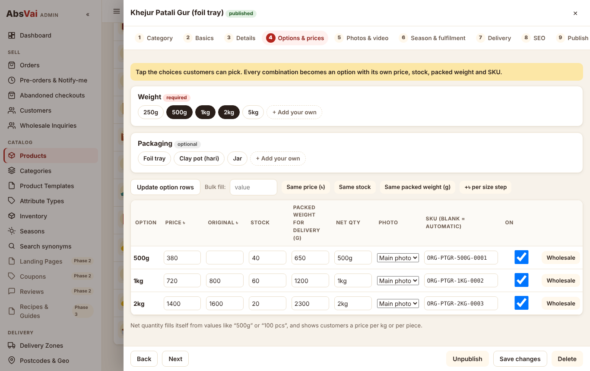

# Abs Vai · absvai.com

Seasonal multi-category marketplace for **ABS VAI LTD**: households buying gur, masala, clothing, gadgets and home items, and
small food businesses buying presses, sealers, tools, packaging and bulk Master Masala. English only, mobile-first, Bangladesh.

One **Cloudflare Worker** (Hono + TypeScript) serves the server-rendered storefront, the admin app and every `/api/*` route,
backed by **D1** (catalog, orders, geo), **KV** (rate limits), **R2** (photos, logo, manuals, claim documents) and the **Workers
Cache**: public pages are answered at the edge and refreshed by tag when an admin saves (the ISR equivalent).

| | |
|---|---|
| Full A–Z specification, v2 (all 34 sections, data model, Mermaid diagrams, what is built vs planned) | [docs/SPEC.md](docs/SPEC.md) |
| Deploy with GitHub Actions to Cloudflare: secrets, token permissions, domain | [docs/DEPLOY.md](docs/DEPLOY.md) |
| Review of the reference site and the Facebook ad creatives | [docs/DESIGN-REVIEW.md](docs/DESIGN-REVIEW.md) |
| Owner guide: products, seasons, the 8 order stages, incomplete and manual orders, returns, block list | [docs/OWNER-GUIDE.md](docs/OWNER-GUIDE.md) |
| Geo data sources, pinned commit and licensing note | [data/geo/SOURCES.md](data/geo/SOURCES.md) |
| Postcode → area match report | [data/geo/reports/postcode-match-summary.md](data/geo/reports/postcode-match-summary.md) |

<p>
  
  
  
</p>


## What is in Phase 1 (this build)

- **Zero-loading storefront** (Section 2): edge-cached pages with `Cache-Tag` purges on every admin save, ad-click parameters
  dropped from the cache key, live price/stock from `/api/live`, prefetch/prerender with Speculation Rules (no tracking fires for a
  prerendered page until it is shown), cross-document view transitions, self-hosted fonts, a service worker, and JS budgets that are
  tested (home ≈ 7 KB, product ≈ 9 KB gzipped).
- **Product templates and smart upload** (Sections 4–5): templates as data drive the form, the product page, card specs and filters.
  Weight, volume, metre, size, colour and model options; three-level categories with drag-and-drop; cost price (Owner/Accountant
  only), GTIN, shelf location, "show on the homepage"; automatic unique SKUs with Code 128 barcodes and printable labels.
- **Checkout with address detection** (Section 7): postcode auto-fill, district-level "Use my location", manual dropdowns, live
  delivery charge by zone and packed weight. No GPS is stored.
- **Incomplete-order engine** (Section 8): one record per checkout session once the phone is valid, converted when the order is
  placed, a recovery queue with assignment and a recovery report, deleted after 60 days.
- **8-stage pipeline** (Section 9): New → Confirmed → Packed → In Courier → Delivered / Partial Delivered / Cancelled / Returned,
  enforced by a state machine. Stock is held at confirmation, leaves with the courier and comes back only on the warehouse
  **returns scan**. Bulk moves, A4 or 4×6 invoices and slips, picking list by shelf.
- **Manual / social orders** (Section 12): Facebook, Messenger, WhatsApp and phone orders with a required source, a paste-chat phone
  finder, barcode-scanner product search, the same pipeline and fraud checks, credited to the staff member.
- **Baseline fraud** (Section 11): Turnstile + signed checkout token, honeypot and timing check, phone/device/IP block list (IP blocks
  expire), repeat-order and 24-hour holds (held for review, never silently rejected), OTP caps, and a reviewable blocked-attempts log.
- **Admin**: stage cards and "needs your attention", six roles enforced on the server, grouped settings with validated tracking IDs,
  encrypted and masked credentials, logo and brand colours with a contrast check, audit log with before/after values.

Phase 2 (payment gateways, courier APIs via Queues with verified webhooks, COD reconciliation, leaderboard, suppliers, segments and
bulk SMS, coupons, landing pages, Pixel + CAPI, analytics) and Phase 3 (POS, accounting, starter kits, recipes, AI chat) are
specified in [docs/SPEC.md](docs/SPEC.md#32-phased-roadmap).

## Quick start (local)

```bash
npm ci
cp .dev.vars.example worker/.dev.vars          # local-only values (ENVIRONMENT=development, SETUP_TOKEN, OTP_PEPPER)
npm run db:migrate:local                        # schema + geo data + launch configuration
npm run db:seed:demo:local                      # optional demo catalog (never run in production)
npm run dev                                     # http://localhost:8787 and http://localhost:8787/admin/
```

On first visit, `/admin/` asks for the `SETUP_TOKEN` and creates the Super Admin. Without an SMS provider, every message (including
OTP codes) is written to **Admin → SMS outbox** with status `logged`.

| Script | What it does |
|---|---|
| `npm run typecheck` | TypeScript build check for the Worker, scripts and tests |
| `npm test` | 181 unit + integration tests (integration runs the real app on local D1/KV/R2 through workerd) |
| `npm run test:e2e` | Playwright: four checkout flows with incomplete capture, notify-me, admin upload form, manual Messenger order to courier |
| `npm run scale:check` | Seeds 1,000,000 orders into SQLite from the real migrations and times every admin order query |
| `npm run gen:geo` | Re-imports geo data and rewrites the match report (before the first production migration only) |
| `npm run gen:seed` | Regenerates the launch configuration and demo SQL from `scripts/seed-defs.ts` |
| `npm run deploy` | Build assets and deploy the Worker |

## Deploying to Cloudflare

GitHub Actions deploys on every push to `main` (and, until it is merged, to the build branch), or from **Actions → Run workflow**.
The job finds or creates D1, KV and R2, applies migrations, deploys the Worker with its secrets in one step and smoke-tests the
live site. Add the repository secrets listed in [docs/DEPLOY.md](docs/DEPLOY.md) (`CLOUDFLARE_API_TOKEN`, `CLOUDFLARE_ACCOUNT_ID`,
`SETUP_TOKEN`, `OTP_PEPPER`, `SIGNING_KEY`, `SETTINGS_KEY`, optional Turnstile and SMS). `absvai.com` and `www.absvai.com` attach
as custom domains once the zone is in the Cloudflare account; until then the deploy goes to `workers.dev`.

## Folder structure

```
absvai.com/
├── worker/
│   ├── src/
│   │   ├── worker.ts      gateway + cached Storefront entrypoint + scheduled handler
│   │   ├── index.ts       Hono app, security headers, CSP from enabled integrations
│   │   ├── routes/        api.ts (public JSON) · pages.tsx (SSR storefront) · admin*.ts (admin API)
│   │   ├── lib/           state-machine · barcode · crypto · csp · cache-tags · settings-schema · templates · delivery-charge · pdf · …
│   │   ├── repo/          every SQL statement (enforced by a test)
│   │   ├── services/      orders · checkout · cart · fraud · incomplete · cache purge · sms
│   │   ├── views/         Hono JSX layout, components and pages
│   │   ├── cron/          season switching, scheduled publish, purge retry, incomplete-order cleanup
│   │   └── generated/     geo-version.ts (written by the geo import)
│   ├── migrations/        0001 schema · 0002 geo data (generated) · 0003 launch configuration (generated)
│   ├── seed/demo.sql      demo catalog for local use and tests
│   └── wrangler.toml
├── scripts/               import-geo.ts · gen-seed.ts + seed-defs.ts · build-assets.mjs · ensure-cloudflare-resources.mjs · scale-check.ts
├── data/geo/              pinned source files · generated outlines · match report
├── public/                storefront CSS, JS, images, manifest
├── admin/                 admin single-page app (vanilla JS modules)
├── tests/                 unit · integration · e2e
├── .github/workflows/
└── docs/
```

## Things to confirm with ABS VAI LTD before launch

1. Logo files and final brand colours (the palette is a starting point; contrast is tested in `tests/unit/contrast.test.ts`).
2. The launch category list and template per category (`scripts/seed-defs.ts`, or edit in admin).
3. Delivery zone charges and the free-delivery threshold (placeholders: ৳70 / ৳100 / ৳130, free over ৳1,500).
4. Advance rules (which products, how much).
5. Which seasons to set up first, with this year's exact dates (Ramadan and Eid move every year; the seasons ship without dates).
6. BSTI / licence numbers and label details for the Master Masala line, checked with BSTI and the Bangladesh Food Safety Authority.
7. Which courier accounts exist (Steadfast, Pathao, RedX, Carrybee) and their API credentials, and the SMS gateway and sender ID.
8. Real product photos: the demo uses original placeholder drawings. No photo from any other shop or reference site is in this repository.
9. Whether a shop counter needs the POS, staff count and roles, and how deep the accounting should go.
