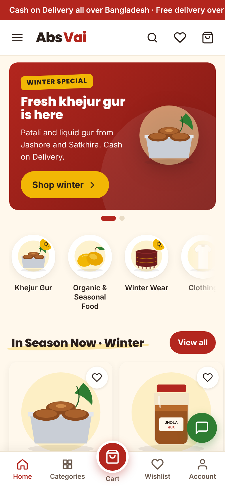
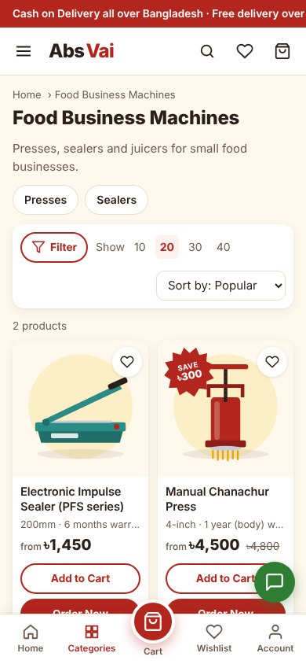
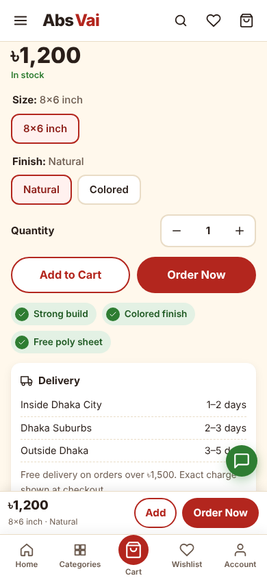
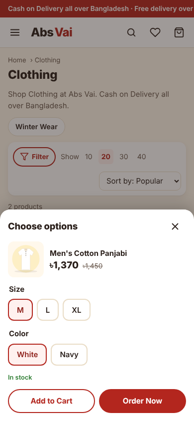
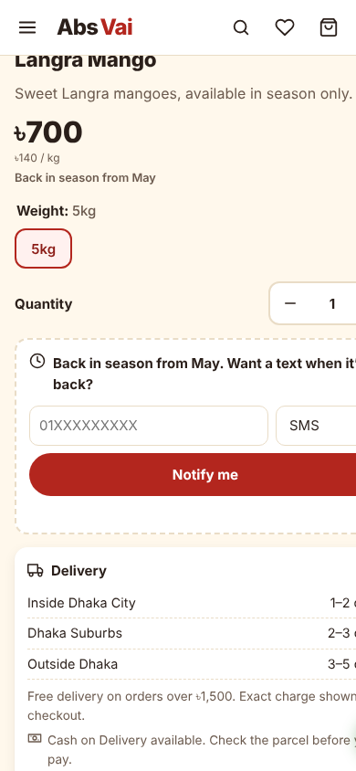
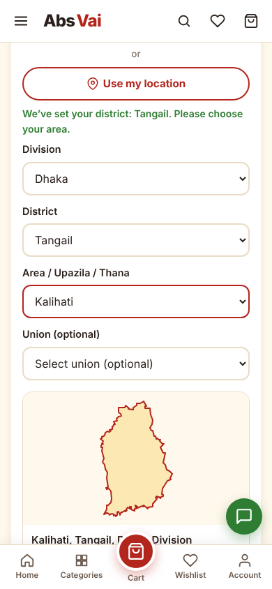
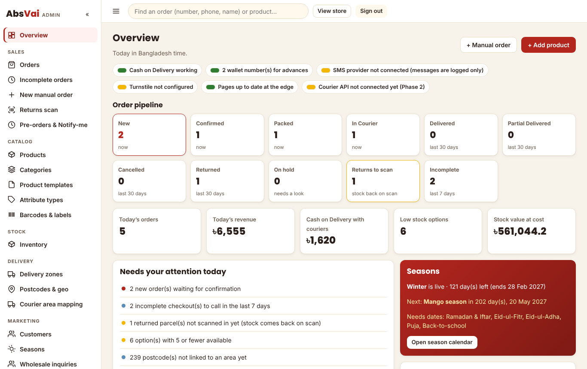
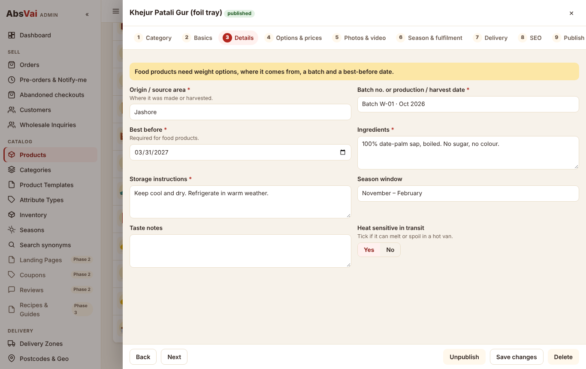
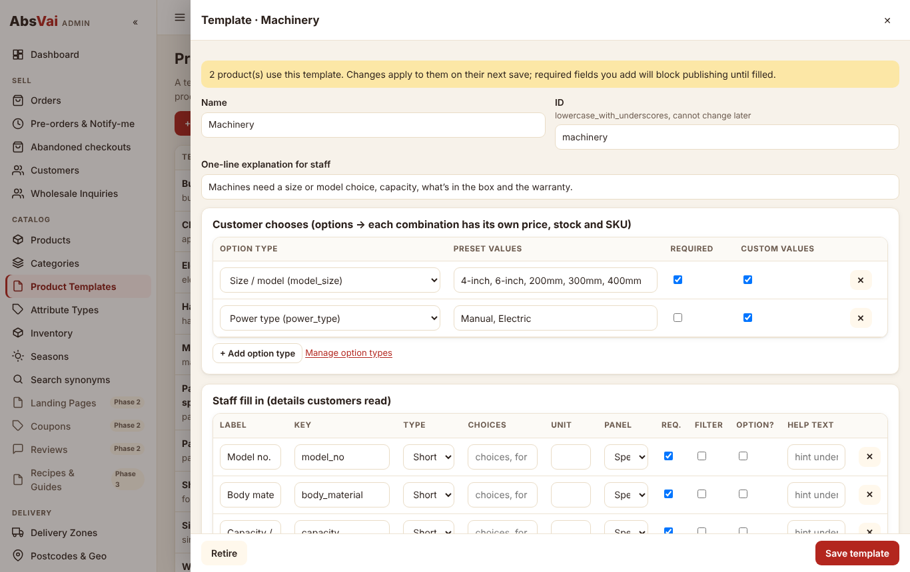

# Design review: reference marketplace and Abs Vai ad creatives

Inputs: six phone screenshots of the reference marketplace (ecom.appbyte.net), eight Facebook ad creatives, and a YouTube link
(`youtu.be/v87sGGhrqbM`).

> **The YouTube video could not be reviewed.** The build environment blocks YouTube's domains, so its title, description and
> content were not accessible and nothing here is based on it. If it shows features that should be in the build, send a short list
> of them (or a screen recording/notes), and they will be checked against [SPEC.md](SPEC.md).
>
> **v2 update:** the v2 build prompt lists the features to take from that material (edge-cached "zero-loading" pages, the
> incomplete-order engine, the 8-stage pipeline with returns scan, manual social orders, block list and OTP caps, barcodes and
> bulk printing, dynamic settings). Those are built from the prompt's text, not from the video, and are mapped section by section in
> [SPEC.md](SPEC.md). Eight v2 admin screens were added to `screenshots/` (dashboard, orders, incomplete orders, manual order, returns
> scan, categories, security, settings).

## 1. Reference marketplace: what we kept

| Pattern in the reference | How Abs Vai does it |
|---|---|
| Red announcement bar | Kept, admin-editable. Text is readable from the first frame, pauses on hover, and is static on desktop and for reduced motion |
| Header: hamburger, logo, search, wishlist, cart with count | Kept. Search shows live suggestions and understands transliterations (phuchka → fuchka) |
| Rounded hero banner with dots | Kept, but season-aware: the live season's banners take over automatically. Dots sit **below** the banner, not on the product |
| Circular category carousel | Kept. Only categories that are live right now; in-season ones first with a small sun badge |
| "Hot Deals" heading + red "View All" | Kept, with a brush-stroke highlight behind section titles (from the ads) |
| Card: discount badge, price + struck-through price, outlined Add to Cart + filled Order Now | Kept. The badge became the circular **price burst** from the ads; a key-spec line from the template ("1kg · Jashore", "300mm · 6 months warranty") and the unit price were added |
| Bottom tabs with a raised centre cart | Kept (Home, Categories, Cart, Wishlist, Account as the brief asks) |
| Drawer menu with a Categories sub-screen with thumbnails | Kept as an expandable list in the same drawer (one less screen) |
| Listing toolbar: Filter, Show 10/20/30/40, Sort | Kept. Filters come from the category's template (weight for food, size/colour for clothing, model for machines) |

## 2. Reference marketplace: problems we fixed

Seen directly in the screenshots:

1. **Floating mini-cart covers content.** The red "0 / ৳0" widget pinned to the right edge sits on top of product names, prices
   ("Premium Qualit…") and the "View All" button. → Removed. The cart count lives in the header and the tab bar; adding to cart shows
   a short toast with "View cart".
2. **The chat bubble covers buttons.** It overlaps cards and the "Order Now" buttons. → Smaller, green (so it isn't confused with red
   action buttons), placed above the tab bar, and moved above the sticky buy bar on product pages.
3. **Carousel arrows sit on the category images.** On mobile the red arrows cover the first and last thumbnails. → Arrows only on
   devices with a mouse; touch screens swipe, with a fade at the edge to show there's more.
4. **Marquee cut mid-sentence** ("বাংলাদেশের বিশ্বস্ত অ…"). → Fixed as above.
5. **Hero pagination drawn over the product photo.** → Below the banner.
6. **Names truncated to one line** ("Men's Genuine Leather…", "Super Water Absorbi…"). → Two lines, then the template key-spec line,
   so the customer still sees what makes the product different.
7. **Mixed Bangla buttons and English names.** → English everywhere, as the brief asks.
8. **Other shops' watermarks on product photos** (a partial "Vi…ul" logo, a "LEATHER HALF SI" banner). → Photo policy: own photos, or
   supplier photos with permission. The build only contains original placeholder drawings.
9. **"Download App" always shown** even with no app. → "Install App" only appears when the browser can actually install the site.
10. **Sort menu with no visible filters.** → The Filter button shows how many filters are active.

## 3. Ad creatives: what carries over to the site

The ads are effective, bold and specific. The site should feel like the ad that was just tapped:

| Ad element | On the site |
|---|---|
| Chili-red and turmeric-yellow headline bands | Hero themes (chili, turmeric, clove, leaf) with a turmeric "kicker" label |
| Round price stickers ("মুল্য ১২০০ টাকা") | The price-burst sticker on cards and product photos. Always live text, never baked into an image |
| Green check-mark benefit chips ("শক্ত মজবুদ", "টেপো পলি ফ্রি") | Check chips on product pages (admin "Benefit chips", plus automatic ones for a free bonus item and free delivery) |
| Big product photo in a real setting | Product galleries. Use the same shoot as the ads, without the text, at 1600px |
| "Free bonus" offers | The handmade-tool template has a "Free bonus item" field that shows as a chip |
| Recipe on the Master Masala box | Becomes the "Recipes & Business Ideas" hub (Phase 3), with "Used for: fuchka, chotpoti…" already on the product |

## 4. Ad creatives: cautions

1. **Do not reuse these on the site:**
   - the clothes-rack creative, which carries another shop's logo (InsafMart) and a phone number;
   - the patali gur image, which comes from other shops' listings (AgroBari / Astha Shop, with their phone number).

   Re-shoot both products. Reusing them can get the page and ads reported for IP infringement.
2. **Text baked into images** can't be read by search engines or screen readers, can't be resized for a phone, and goes stale when
   the price changes. On the site, keep headlines, prices and chips as real text over clean photos.
3. **Yellow text on light backgrounds** fails contrast. Yellow works only behind dark text (tested in the build).
4. **The chanachur-machine ad shows a person.** Get written permission before using that photo on the website.
5. **Master Masala label**: check the required label information (ingredients, net weight, manufacturer address, dates,
   BSTI/licence) with BSTI and the Bangladesh Food Safety Authority before launch. The packaged-food template already asks for these.
6. **Claims**: "100% Natural" on the masala box needs a supporting document before the site shows it as a badge. Health claims are
   blocked by the system.

## 5. Screens as built

| Storefront | |
|---|---|
|  |  |
|  |  |
|  |  |

| Admin |
|---|
|  |
|  |
|  |
