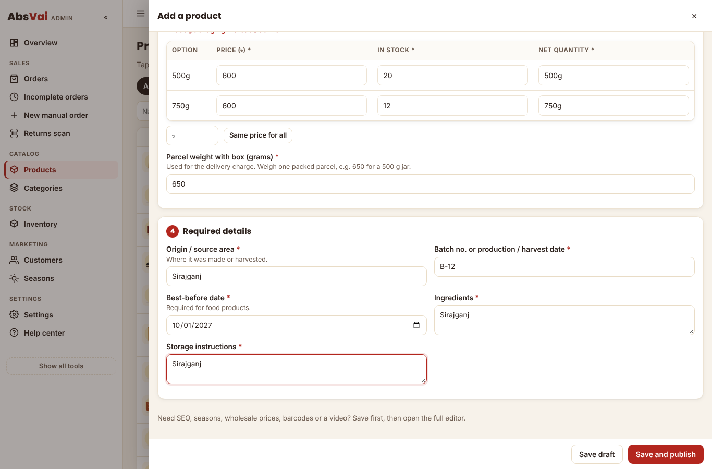
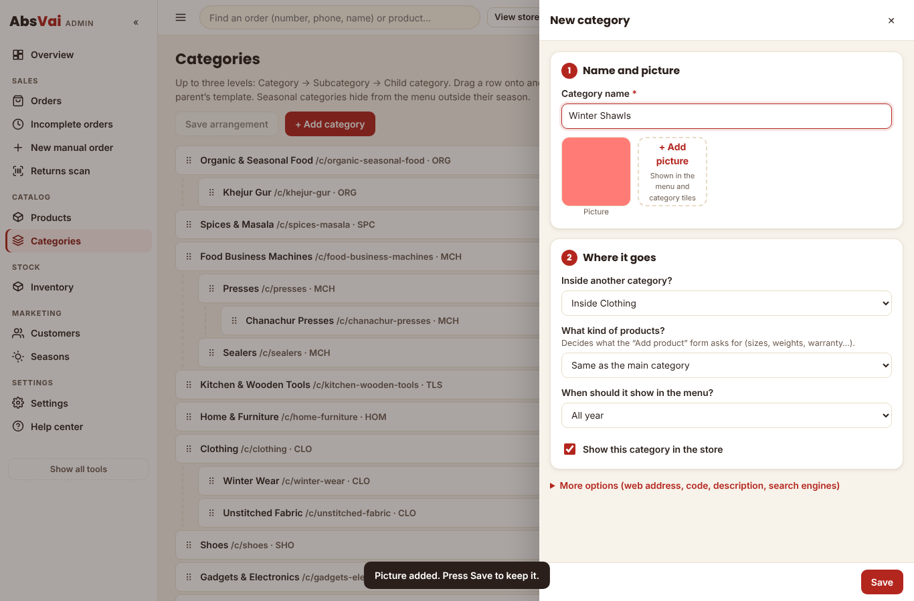
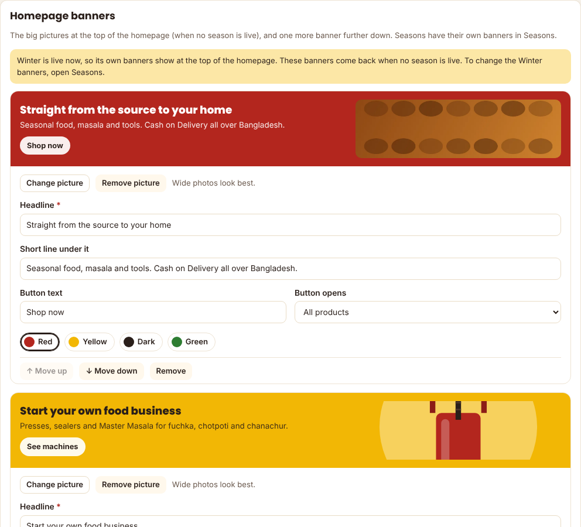
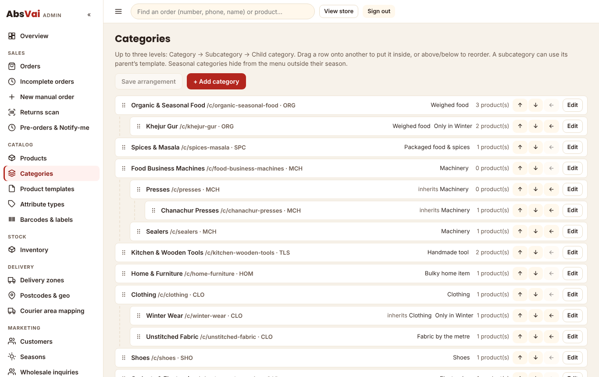
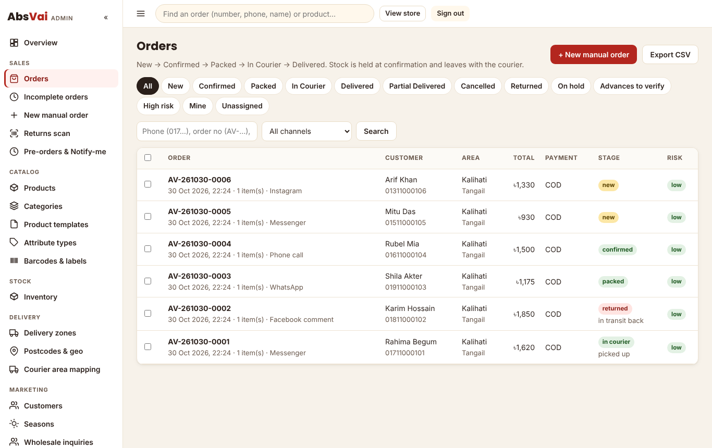
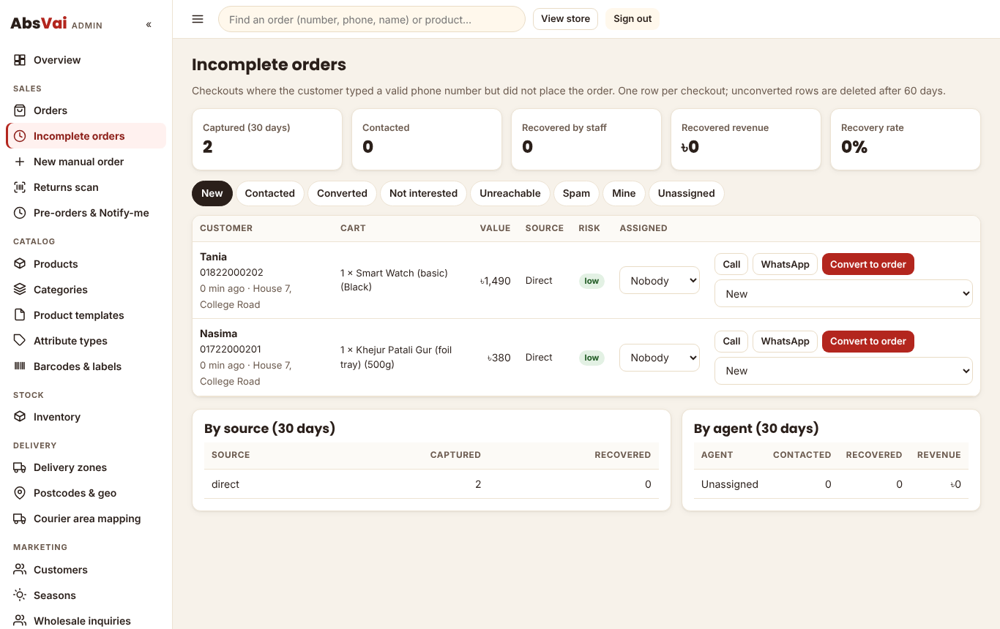
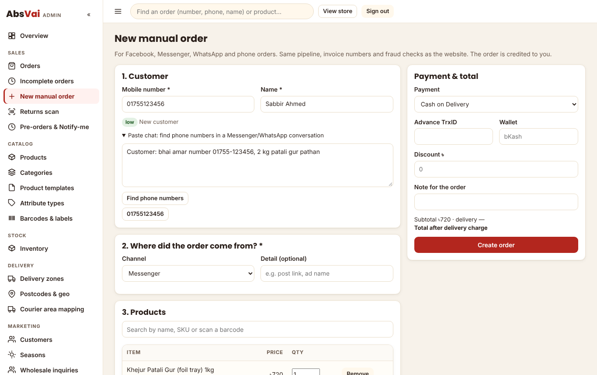
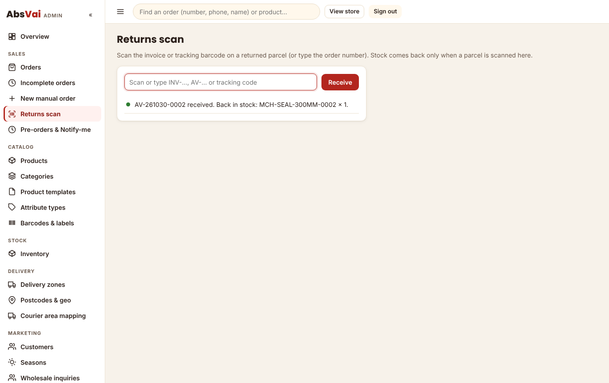
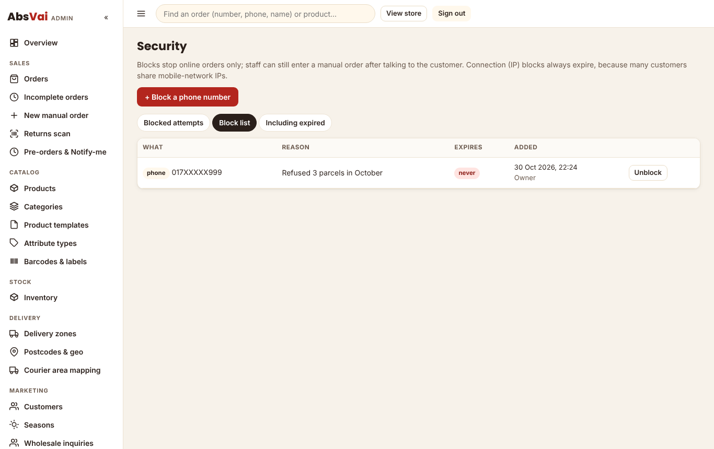

# Abs Vai owner guide

Plain steps for running the store from `absvai.com/admin/`. No coding needed.

## First sign-in

1. Open `absvai.com/admin/`. The first time, it asks for the **setup token** (your developer gives it to you once), your name,
   email and a password (10+ characters with a number). This creates the **Super Admin**.
2. Go to **Settings** and fill in: support phone, WhatsApp number, social media links, **bKash/Nagad/Rocket numbers** (for advances),
   company address (printed on invoices), the free-delivery amount and the announcement bar text. Under **Branding**, upload your
   logo and (if you like) change the colours; the page warns you if a colour would make text hard to read. Under **Tracking**, paste
   only the ID (for example `GTM-AB12CD3`), never script code. Credentials (SMS, courier, payment) show as `••••1234` once saved.
3. Go to **Staff & roles** and add your team:
   - **Manager**: products, orders, discounts, settings, security.
   - **Sales Agent**: orders assigned to them, manual orders, incomplete checkouts. They see a full phone number only on their own orders.
   - **Warehouse**: packing, printing, sending to the courier, the returns scan and stock.
   - **Accountant**: orders, exports and cost prices.
   - **Viewer**: can look but not change anything.
   Tick **On duty** for the agents working today.

## The menu

The admin opens in a **simple menu** with the everyday screens: Overview, Orders, Products, Categories, Inventory, Customers,
Seasons and Settings. Press **Show all tools** at the bottom of the menu for everything else (delivery zones, templates, security,
audit log…), and **Simple menu** to go back. The Overview shows the last 30 days: sales and orders per day, how many website
customers go from checkout to delivery, the districts that order most, your best customers and where orders come from.

## Add a product (the quick way)

**Products → + Add product** opens one page:

1. **Photos**: press *+ Add photos* and pick them from your phone or computer. The first one is the main photo.
2. **What is it?**: choose the category, type the name and one line about it.
3. **Sizes, prices and stock**: tap the sizes or weights you sell (*+ Other* for an odd one), then type the price and how many you
   have. *Same price for all* fills every row. Type the **parcel weight with the box** once.
4. **Required details**: only what this category needs (food: origin, batch, best-before, ingredients, storage).
5. Press **Save and publish**. If something is missing, it tells you in plain words and keeps it as a draft.

To change a price, stock or photo later, tap the product in the list: the same page opens. **Full editor** (on each row) has
everything else: SEO, seasons, wholesale prices, barcodes, video.

## Add a category

**Categories → + Add category**: type the name, add a picture, choose whether it sits inside another category, and what kind of
products it holds (a subcategory uses its main category's kind). Press **Save**. The short code is made for you.

## Website & banners: shop name, logo, banners and the popup

**Website & banners** (in the menu) is where you change how the shop looks:

- **Shop name and logo**: type the shop name (it shows at the top of every page when there is no logo), a short line about the
  shop, and press **+ Upload logo**. **Remove logo** goes back to showing the name. The running message at the very top is here too.
- **Big banners at the top of the homepage**, the **popup banner** and the **second banner** use the same banner editor below.

Each banner shows a live preview while you type.

1. Press **+ Add picture** and choose a photo from your phone or computer (wide photos look best; it is made smaller for you).
2. Type a **headline**, and if you like a short line under it and the button text.
3. Under **Button opens**, pick the page: the shop, deals, new arrivals, any category or season. **Another link…** lets you paste
   your own.
4. Pick a colour. Use **Move up / Move down** to change the order, **Remove** to delete one.
5. Press **Save** at the bottom of the screen.

**Popup banner**: tick **Show the popup**, make the banner, then choose after how many seconds it appears, how often (once a day,
only once per customer, or every visit) and where (homepage only or every page). It never shows on the cart, checkout or account
pages, and customers can close it.

The **second banner** sits further down the homepage. While a season is live, the season's own banners show at the top instead
(the page tells you so); change those in **Seasons**, which uses the same banner editor.

**Settings → Store → Social media**: paste the full link of your Facebook page, Instagram, YouTube or TikTok (for example
`https://www.facebook.com/absvai`). Leave a box empty to hide it. They show in the footer of every page.

Tracking, fraud protection, SMS, couriers and incomplete orders are under **Advanced settings** at the bottom. You only need them
once, while setting up.

## Emails

**Emails** (in the menu) shows whether email is connected and lists every email the shop sent, with the reason if one failed.

- **To you** (the address in “Send shop alerts to”, absvai1020@gmail.com): every new order, cancelled / returned / delivered
  orders, wholesale inquiries, and a summary every morning at about 12:05 am (yesterday’s orders and what needs your attention).
- **To customers** who type their email at checkout (it is optional): the receipt when they order, the **invoice** when you
  confirm, “on the way” with the courier and tracking ID, and “delivered”.
- **Offers**: customers can tick “Email me offers” at checkout. **Send an offer** emails them all; each email has an
  unsubscribe link and you get a copy.
- Press **Send me a test email** to check it works.

Email is sent with Resend. The key is the GitHub secret **RESEND_API_KEY** (GitHub → Settings → Secrets and variables →
Actions); the deploy copies it to the Worker. Until your own domain (for example absvai.com) is verified in **Resend → Domains**,
Resend delivers only to the email address of the Resend account, so customer emails are skipped and say so. After verifying
the domain, change **Emails come from** to an address on it, such as `Abs Vai <orders@absvai.com>`.

## Sellers (marketplace)

Other sellers can sell through your shop. You stay in charge: orders, calls, delivery and money still go through you.

1. **A seller registers** at `/sell` (the footer has a "Sell on Abs Vai" link): shop name, their name, mobile, email,
   password, district, what they sell and how they want to be paid (bKash, Nagad, Rocket or bank).
2. **You approve the seller** in **Sellers** (in the menu). Open the seller, set the **commission** (%) you keep on each
   delivered sale, and press **Approve seller**, or **Don’t approve** with a short reason. Until you approve, they can’t sign in.
3. **The seller signs in** at `/seller/` and adds products with photos, details, prices, stock and parcel weight, then presses
   **Send for approval**. Sellers can’t set cost prices, the homepage, seasons, free delivery or Abs Vai Originals.
4. **You approve each product** in **Sellers → Products to approve**: **Open** to check it, then **Approve & publish**, or
   **Send back** with what to change. Approved products show in the shop with “Sold by …” and on the seller’s store page
   `/store/<their-name>`.

After that, the seller can change **price and stock** at any time (live at once). Any other change hides the product until
you approve it again. Sellers see their **orders** (product, quantity, area, status; never the customer’s phone) and their
**earnings** after commission for delivered sales. **Pause seller** hides all their products and signs them out; **Re-open**
brings them back. You get an email for every new application and every product waiting for approval.

## Couriers: Steadfast and Pathao

**Couriers** (in the menu, under Delivery) connects your courier accounts. Keys are saved encrypted; only the Owner / Super
Admin can change them.

| Courier | Where to find the keys | Paste into Couriers | Webhook to add in the courier's panel |
|---|---|---|---|
| Steadfast | Steadfast merchant panel → API | **API Key**, **Secret Key** | **Callback URL** `https://absvai.absvai.workers.dev/api/webhooks/steadfast` and the **Auth Token (Bearer)** shown on the Couriers page |
| Pathao | Pathao merchant panel → Developers API → Merchant API Credentials | **Client ID**, **Client Secret**, your Pathao **login email** and **password**; then **Test connection** and pick the **pickup store** | The **Callback URL** shown on the Couriers page (it ends with a secret code). If Pathao shows an integration secret, paste it into Couriers |

After `absvai.com` is connected, the addresses change to `https://absvai.com/…`; the Couriers page always shows the right ones.

Press **Test connection** after saving: Steadfast shows your balance, Pathao lists your pickup stores.

**Booking**: open a **Packed** order → **Book with Steadfast** or **Book with Pathao**, or tick several packed orders in the
list → **Book with Steadfast / Pathao** (up to 50 at a time). The courier sends back the tracking ID, the order moves to
**In Courier**, and the customer gets the tracking SMS (and email). The amount to collect is the order total minus any advance
already received. The first time Pathao delivers to an area, choose Pathao's city and zone for it once; it is remembered.

**Tracking**: when the courier updates a parcel, the order updates by itself: delivered parcels move to **Delivered**, returned
or cancelled ones to **Returned** (scan them in when they arrive), and picked up / in transit / on hold show on the order. If a
courier goes quiet, the shop asks it every few hours.

## Chat and the assistants

The green chat button on the shop opens a small menu: **Ask our shop assistant** (instant answers about products, delivery
charges, Cash on Delivery and returns, in Bangla or English) and **Chat on WhatsApp**. The assistant only uses your shop’s
own products, prices and rules; for anything about an order it sends customers to Track order, WhatsApp or a call.

In the admin, the **Assistant** button (bottom right, on every page) answers “how do I…?” questions step by step from this
guide and your live numbers (orders waiting, stock running low…).

Both run on Cloudflare Workers AI, inside the free daily allowance (about 400 answers a day). **Settings → Advanced → AI
assistants** sets how many AI answers per day each may use; after that they use their built-in answers until the next day.

## SMS code at checkout

The SMS code (OTP) on Cash on Delivery orders is **off** until an SMS gateway is connected. Customers are not asked for a
code; the order page says “We’ll call you to confirm”. When the SMS gateway is connected, tick **Settings → Advanced → SMS →
Ask for an SMS code on Cash on Delivery orders**.

## Add a product (full editor, every detail)

1. **Products → Full editor** (or open the full editor from the quick page). Pick the **category first**: it decides what the form asks for. Food asks for weight, origin,
   batch and best-before. Machines ask for model, warranty and what's in the box. Clothing asks for size, colour and a size chart.
2. **Basics**: name, a one-line short description (shown on cards), the full description, and up to 4 benefit chips (real facts
   only, like "5 dies included").
3. **Details**: fill the fields. Ones marked * are needed to publish. If customers pick something that is normally a detail (for
   example teak or mahogany for the same rack), tick **Customers choose this**.
4. **Options & prices**: tap the sizes/weights you sell (honey and ghee use **volume**, fabric uses **metres**). Use **+ Add your
   own** for an odd size like "3kg family pack". Press **Update option rows**, then fill price, stock and **packed weight for
   delivery** (the weight of the parcel, box included). Leave SKU empty and the system makes one, with a barcode. The **Cost** column
   (only you and the accountant see it) feeds the stock value. Add the **GTIN/EAN** printed on a supplier's pack if there is one, and
   the **shelf** so the picking list sends packers to the right place. Use **Wholesale** for a lower price from, say, 5 packs.
5. **Photos & video**: drop your photos (they are made smaller on your phone or computer before upload). The first photo is the main
   one. Paste a YouTube link for "How it works". Machines can have a PDF manual.
6. **Season & fulfilment**: tick the season if it only sells then (gur → Winter). Choose **Pre-order** to take bookings before stock
   arrives (set the dispatch date and the advance), or **Made to order** with the days needed.
7. **Delivery**: tick free delivery if you offer it. Large items (furniture, presses) use the bulky charge, or "confirmed by phone".
8. **SEO**: usually leave as it is. Add other names people search for ("nolen gur, patali").
9. **Publish**: it lists anything missing in plain words. Press **Publish**, or **Schedule** it for the first day of a season.

**Barcode labels**: **Barcodes & labels** → find the options → choose copies and A4 sticker sheet or thermal roll → print.

**Show on the homepage**: tick it in Basics to put the product in the homepage "Featured" rail.

**Copy a similar product**: in the product list press **Duplicate**. Everything is copied except SKUs and stock.

**Many products at once**: **CSV import** → pick the category → download its CSV template → fill one row per option → upload.
Everything comes in as a draft for you to check.

## Start a season

1. **Seasons** → open the season → set this year's **start and end dates**. Ramadan and Eid move every year, so check the dates
   every year. The dashboard reminds you when dates are missing.
2. Add one or two **banners**: a photo, a headline and the page the button opens (same editor as the homepage banners).
3. Make sure the season's products are ticked in step 6 of their form, and seasonal categories are set to "Only during these
   seasons" in **Categories**.
4. On the start date, by itself: the homepage shows the season's banners and "In Season Now", the categories move to the front, and
   everyone who pressed **Notify me** gets one SMS. On the end date, they step back. The pages stay online with "Back in season from …".
5. Next year: **Copy last year's seasons** keeps everything and clears the dates for you to enter.

## Categories

Up to three levels: **Category → Subcategory → Child category** (for example Food Business Machines → Presses → Chanachur Presses).
Drag a row onto another to put it inside, or above/below to change the order, then press **Save arrangement**. A subcategory can
use its parent's template ("inherits"). The menu on every page updates within seconds.

## The eight order stages

| Stage | What it means | What you do |
|---|---|---|
| **New** | Just placed | Confirm (below). Orders **on hold** wait for you to look first |
| **Confirmed** | The customer is real and wants it. Invoice number created, stock set aside | Pack it |
| **Packed** | In a box with its slip | Hand to the courier |
| **In Courier** | With the courier, tracking ID saved, stock leaves | Update the courier status if you like |
| **Delivered** | Received and paid | Nothing |
| **Partial Delivered** | The customer kept some items | Scan the parcel when it comes back |
| **Cancelled** | Stopped before shipping; stock goes back | Nothing |
| **Returned** | Refused or undeliverable | **Scan it in** when it reaches you (stock comes back only then) |

**Confirm an order**
1. If the customer typed the SMS code, the order shows "Verified" and you can move it to **Confirmed** right away.
2. If not, call them, choose the result (Confirmed / No answer / Call back / Wrong number / Wants to cancel) and press **Log call**.
3. Pre-orders and large items need the advance: check the transaction ID in your bKash/Nagad app, then **Mark received**.
4. **On hold** means the same phone or device ordered again within 10 minutes, or more than 3 times in a day. Call, then **Release
   hold** with a short note, or cancel it as a duplicate. Nothing is rejected without a person looking.

**Pack and send many at once**: tick the orders → **Invoices (A4)** or **Invoices (4×6)** for the courier labels, **Picking list**
for the warehouse (totals per product, sorted by shelf), then **Move to → Packed**, and **Move to → In Courier** with the courier
and a tracking ID for each.

## Incomplete orders

When someone types a valid phone number at checkout but doesn't finish, it appears here (one line per checkout, with the cart).
Call or WhatsApp them, set the result (Contacted, Not interested, Unreachable, Spam), or press **Convert to order** to open a manual
order with everything filled in. If they finish on their own, it turns **Converted** by itself. The report shows how many you
recovered and the money they brought in. Unfinished ones are deleted after 60 days.

## Orders from Facebook, Messenger, WhatsApp or phone

**Sales → New manual order.** Type the phone first: you see their earlier orders, returns and saved addresses. **Paste chat** finds
the phone numbers in a copied conversation. Choose **where the order came from** (required), search the product (or scan its
barcode), fill the address with the postcode, and press **Create order**. It goes through the same stages and checks as website
orders and is credited to you. Sales Agents can give a discount up to 10 % (change it in Settings).

## Returns scan

When a returned parcel reaches you, open **Sales → Returns scan** and scan the barcode on its invoice or courier label (or type the
order or tracking number). The items go back into stock and the order is marked received. A parcel can only be received once.

## Block list and blocked attempts

**Security → Block list**: block a phone number with a reason ("Refused 3 parcels"). Blocked customers can't order online and are
asked to call you; you can still take their order by phone after talking to them. You can also block a device or a connection from
an order or an attempt. Connection blocks always expire, because many mobile customers share one connection.

**Blocked attempts** lists everything the system stopped or held. If a real customer was caught, press **Review**, add a note and
remove the block in one step.

## Fix a postcode

Most postcodes fill the customer's area automatically. About 240 (mostly city thanas like Palton, Dhanmondi, Mirpur) only fill the
district, so the customer picks the area themselves. To fix them:

1. **Postcodes & Geo → unmatched**, choose the district (for example Dhaka).
2. Tick the postcodes that belong to one area (for example the Dhaka South city thanas) and choose the area in **Bulk assign**.
3. Press **Assign**. Checkout uses the fix immediately.

The **fuzzy** tab lists postcodes linked by similar spelling. Glance through it once.

## Delivery charges

**Delivery Zones**: change the base charge, the weight it covers, the price per extra kg, the large-item charge and the delivery
time. Move a district to another zone with its dropdown, or give one area (like Dhaka North City) its own zone with **Area
overrides**.

## Good to know

- **SMS outbox** shows every message the store sends. Until an SMS company is connected, messages are saved there but not sent.
- **Inventory → Adjust** when new stock arrives or something is damaged, expired or missing (a reason is required); for food, type
  the batch number so a complaint can be traced to its batch. **Held** shows stock set aside for confirmed orders.
- **Settings → Refresh every page now** if a change made outside the admin doesn't show on the site.
- **Customers**: tick *trusted* for regular customers who always accept their parcels.
- Never list raw date-palm sap (kacha khejur rosh): Nipah virus risk. Boiled gur and patali are fine.
- Only switch on badges like "Organic" when you can attach the certificate or supplier declaration. Never claim a product cures or
  boosts health.
