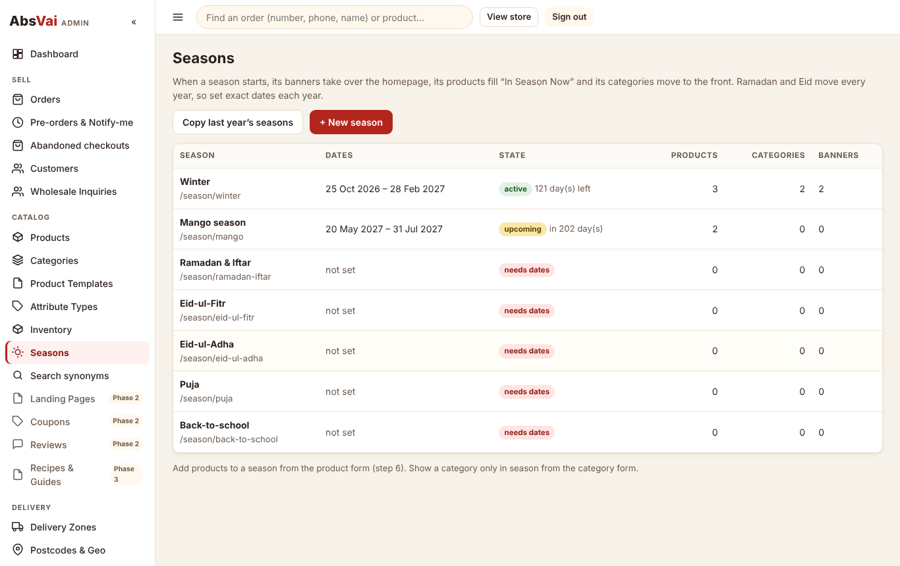
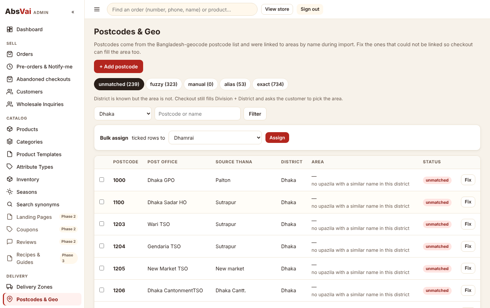

# Abs Vai owner guide

Plain steps for running the store from `absvai.com/admin/`. No coding needed.

## First sign-in

1. Open `absvai.com/admin/`. The first time, it asks for the **setup token** (your developer gives it to you once), your name,
   email and a password (10+ characters with a number). This creates the **Super Admin**.
2. Go to **Settings** and fill in: support phone, WhatsApp number, Facebook page, **bKash/Nagad/Rocket numbers** (for advances),
   company address (printed on invoices), the free-delivery amount and the announcement bar text.
3. Go to **Staff & Roles** and add your team:
   - **Manager**: products, seasons, orders, delivery.
   - **Order Processor**: orders and customers only.
   - **Viewer**: can look but not change anything.

## Add a product

1. **Products → + Add product.** Pick the **category first**: it decides what the form asks for. Food asks for weight, origin,
   batch and best-before. Machines ask for model, warranty and what's in the box. Clothing asks for size, colour and a size chart.
2. **Basics**: name, a one-line short description (shown on cards), the full description, and up to 4 benefit chips (real facts
   only, like "5 dies included").
3. **Details**: fill the fields. Ones marked * are needed to publish. If customers pick something that is normally a detail (for
   example teak or mahogany for the same rack), tick **Customers choose this**.
4. **Options & prices**: tap the sizes/weights you sell. Use **+ Add your own** for an odd size like "3kg family pack". Press
   **Update option rows**, then fill price, stock and **packed weight for delivery** (the weight of the parcel, box included). Leave
   SKU empty and the system makes one. Use **Wholesale** to give a lower price from, say, 5 packs.
5. **Photos & video**: drop your photos (they are made smaller on your phone or computer before upload). The first photo is the main
   one. Paste a YouTube link for "How it works". Machines can have a PDF manual.
6. **Season & fulfilment**: tick the season if it only sells then (gur → Winter). Choose **Pre-order** to take bookings before stock
   arrives (set the dispatch date and the advance), or **Made to order** with the days needed.
7. **Delivery**: tick free delivery if you offer it. Large items (furniture, presses) use the bulky charge, or "confirmed by phone".
8. **SEO**: usually leave as it is. Add other names people search for ("nolen gur, patali").
9. **Publish**: it lists anything missing in plain words. Press **Publish**, or **Schedule** it for the first day of a season.

**Copy a similar product**: in the product list press **Duplicate**. Everything is copied except SKUs and stock.

**Many products at once**: **CSV import** → pick the category → download its CSV template → fill one row per option → upload.
Everything comes in as a draft for you to check.

## Start a season

1. **Seasons** → open the season → set this year's **start and end dates**. Ramadan and Eid move every year, so check the dates
   every year. The dashboard reminds you when dates are missing.
2. Add one or two **banners** (headline, sub-line, button, photo).
3. Make sure the season's products are ticked in step 6 of their form, and seasonal categories are set to "Only during these
   seasons" in **Categories**.
4. On the start date, by itself: the homepage shows the season's banners and "In Season Now", the categories move to the front, and
   everyone who pressed **Notify me** gets one SMS. On the end date, they step back. The pages stay online with "Back in season from …".
5. Next year: **Copy last year's seasons** keeps everything and clears the dates for you to enter.

## Confirm and ship orders

1. **Orders → To confirm.**
2. If the customer typed the SMS code, the order shows "Verified" and you can **Update status → Confirmed** right away.
3. If not, call them. Choose the call result (Confirmed / No answer / Call back / Wrong number / Wants to cancel) and press **Log
   call**. A Cash on Delivery order can't be confirmed without one of these.
4. Pre-orders and large items need the advance. Check the transaction ID in your bKash/Nagad app, then press **Mark received**.
5. Confirming creates the invoice number (INV-…) and texts the customer. **Download PDF** or **Print**.
6. Pack, then **Shipped** with the courier and tracking ID; the customer gets an SMS. Select several orders to update them together.
7. A red "possible duplicate" badge means the same person ordered the same thing twice in a few minutes: cancel one with one tap.

## Fix a postcode

Most postcodes fill the customer's area automatically. About 240 (mostly city thanas like Palton, Dhanmondi, Mirpur) only fill the
district, so the customer picks the area themselves. To fix them:

1. **Postcodes & Geo → unmatched**, choose the district (for example Dhaka).
2. Tick the postcodes that belong to one area (for example the Dhaka South city thanas) and choose the area in **Bulk assign**.
3. Press **Assign**. Checkout uses the fix immediately.

The **fuzzy** tab lists postcodes linked by similar spelling. Glance through it once.

## Delivery charges

**Delivery Zones**: change the base charge, the weight it covers, the price per extra kg, the large-item charge and the delivery
time. Move a district to another zone with its dropdown, or give one area (like Dhaka North City) its own zone with **Area
overrides**.

## Good to know

- **SMS outbox** shows every message the store sends. Until an SMS company is connected, messages are saved there but not sent.
- **Inventory → Adjust** when new stock arrives; for food, type the batch number so a complaint can be traced to its batch.
- **Customers**: tick *trusted* for regular customers who always accept their parcels.
- Never list raw date-palm sap (kacha khejur rosh): Nipah virus risk. Boiled gur and patali are fine.
- Only switch on badges like "Organic" when you can attach the certificate or supplier declaration. Never claim a product cures or
  boosts health.
