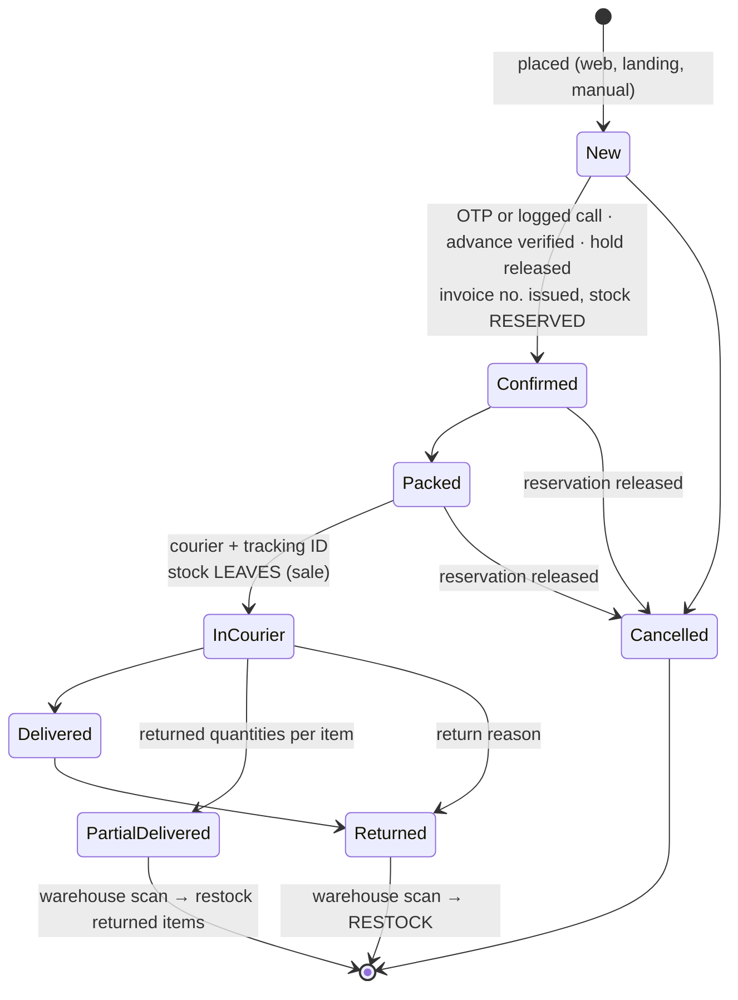
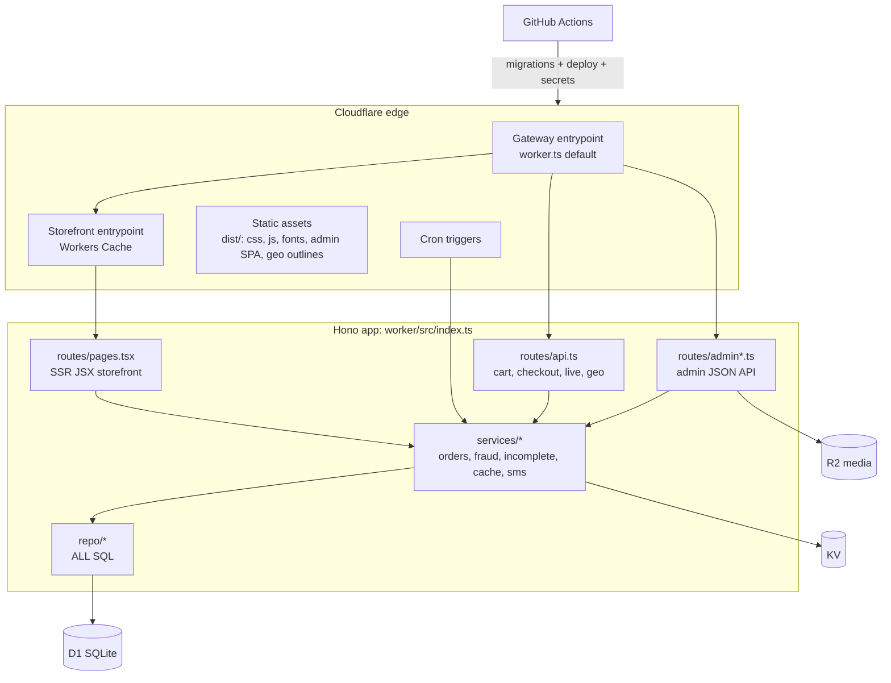

# Abs Vai (absvai.com): A–Z build specification, v2

Client: **ABS VAI LTD** · Domain: **absvai.com** · Stack: Cloudflare Workers (Hono + TypeScript, server-rendered JSX), D1,
KV, R2, Workers Cache, GitHub Actions. English-only storefront, admin, invoices and SMS. Mobile-first, Bangladesh.

This document follows the numbering of the v2 build prompt (34 sections). Each section states the requirement, **what is built**
in this repository (with the files that implement it) and what is **planned**. "Built" means implemented and covered by the test
suites unless it says otherwise.

Legend: **Built** = in this release (Phase 1) · **Planned P2 / P3** = later phase, specified here; where the table already exists it
is named. Courier, payment-gateway and webhook details are **not** written from memory: each integration is marked *confirm* until
the provider's official documentation and the client's credentials are in hand (Section 33).

Stack translations (kept on purpose): Redis + BullMQ / Laravel Queue → **Cloudflare Queues** (Phase 2); Next.js ISR → **Workers
Cache with tag-based purge**. There is no Redis, Laravel or Next.js server anywhere.

---

## 1. Brand & Business Requirements

| Requirement | Status |
|---|---|
| Identity "Abs Vai", text wordmark until the client's logo is uploaded | **Built**: `views/layout.tsx` (wordmark, or the uploaded logo from Settings → Branding) |
| English everywhere, no language toggle | **Built**. SMS pass through `lib/sms.ts → toGsm7()`; a unit test keeps every template in one 160-character segment |
| Transliterated search ("phuchka", "nolen gur", "moshla") | **Built**: `search_synonyms`, `lib/search.ts`, admin-editable |
| Cash on Delivery first; mobile-wallet advances | **Built**: COD + bKash/Nagad/Rocket advance by transaction ID with staff verification. **Planned P2**: hosted gateways |
| Non-technical team | **Built**: guided forms with plain-language errors, Help Center, [OWNER-GUIDE](OWNER-GUIDE.md) |
| No reference-site logos, branding or photos | **Built** as policy: only original placeholder drawings ship; see [DESIGN-REVIEW](DESIGN-REVIEW.md) |

## 2. Performance Architecture: the "Zero-Loading" Storefront

```mermaid
flowchart LR
  B[Browser / Facebook in-app browser] -->|GET public page| G[Gateway entrypoint<br/>cache OFF]
  G -->|public GET: /, /c, /p, /season, /lp, /policies,<br/>/api/live, geo JSON, media| S[Storefront entrypoint<br/>Workers Cache ON]
  S -->|miss / revalidate| A[Hono app: SSR JSX]
  G -->|cart, checkout, account, admin, API writes| A
  A --> D1[(D1)]
  A --> KV[(KV: rate limits, sessions)]
  A --> R2[(R2: media)]
  Admin[Admin save] -->|queue tags in D1 cache_purges| Q[purge()]
  Q -->|ctx.exports.Storefront.purgeTags| S
  Cron[Cron every 30 min] -->|retry backlog| Q
```

### 2.1 Edge caching (the ISR equivalent) — **Built**
- `worker/src/worker.ts`: the default export is a thin **gateway** (cache off). Public `GET/HEAD` requests for edge-served paths go to
  the **`Storefront` entrypoint** through `ctx.exports.Storefront.fetch()` with `cf.cacheKey` set to a normalised key; everything else
  (cart, checkout, account, admin, writes) runs in the gateway. `wrangler.toml`: `[cache] enabled = true`,
  `[exports.default.cache] enabled = false`, `[exports.Storefront.cache] enabled = true`.
- `lib/cache-tags.ts → cacheKey()` keeps only meaningful query parameters (`page`, `show`, `sort`, `min`, `max`, `ids`, `f.*`, `a.*`),
  so every Facebook ad click (`fbclid`, `utm_*`, `gclid`) hits the same cached page. Unit tested.
- Every cached page sends `Cache-Tag` (`site` + what it shows: `home`, `cat-<id>`, `prod-<id>` for every card, `season-<slug>`,
  `lp-<id>`, `listings`, `policies`), `CDN-Cache-Control: public, max-age=86400, stale-while-revalidate=600`, browser
  `max-age=0, must-revalidate`, and an `ETag`; revalidation of an unchanged page answers **304**. Private pages send
  `Cache-Control: private, no-store`. Integration tested.
- Admin saves call `refresh(c, tags)` → `services/cache.ts → purge()`: tags are de-duplicated in D1 (`cache_purges`) and flushed in
  the background in chunks of 100 through `Storefront.purgeTags()` → `ctx.cache.invalidate({ tags })` (scoped to that
  entrypoint). Failures stay queued; the 30-minute cron retries. The dashboard's System Health shows the backlog.

| Change | Tags refreshed |
|---|---|
| Product save, publish, stock adjustment, duplicate, delete | `prod-<id>`, its category, `home`, `listings` |
| Category save / drag-and-drop | `site` (menu), `home`, each moved `cat-<id>` |
| Season save / start / end | `site`, `season-<slug>` |
| Branding, announcement, tracking IDs, contact numbers | `site` (every page) |
| "Refresh every page now" (Settings) | `site` |

### 2.2 Live price and stock on cached pages — **Built**
`GET /api/live?ids=…` (cached 10 s browser / 15 s edge) returns price, compare-at price, **available** (`stock − reserved`) and the
availability label per variant. `public/js/app.js → setupLive()` and `product.js` refresh visible cards and the product page after
load, so a cached page never sells stock that is gone.

### 2.3 Prefetch and prerender — **Built**
Speculation Rules inline in `<head>` (CSP `'inline-speculation-rules'`): **prefetch** every public link on hover (moderate
eagerness) and **prerender** product links on press (conservative); cart, checkout, account, order, API and admin links are excluded. Browsers without Speculation Rules get an
IntersectionObserver prefetch fallback. Cross-document **View Transitions** (`@view-transition { navigation: auto }`, disabled for
reduced motion). `public/js/track.js` waits for `prerenderingchange`, so a prerendered page fires **no Pixel or analytics** until the
visitor actually opens it.

### 2.4 Page-weight rules — **Built**
Self-hosted fonts (`@fontsource` Inter + Poppins, latin subset); no Google Fonts. Poppins 800 and Inter 400 are preloaded;
headings (Poppins) use `font-display: swap`, body text (Inter) `optional`, so text is never re-drawn while people read. No framework
on the storefront. Budgets enforced by `tests/unit/architecture.test.ts` and `tests/unit/first-load.test.ts`: home/listing JS
< 50 KB gzipped (actual ≈ 6 KB, minified at build), product page < 100 KB (actual ≈ 8 KB), stylesheet < 12 KB gzipped.

**First paint in one download**: the minified stylesheet (≈ 7 KB brotli) and the brand colours are put inside every page
(`worker/src/lib/page-css.ts`, read once per isolate from the static assets; the page links `/css/app.css` if that fails), which
saves a round trip before anything can show (measured on a Lighthouse-style slow-4G phone: first paint 0.91 → 0.68 s on the
homepage, 0.76 → 0.59 s on a product page). Homepage sections below the first screen use `content-visibility: auto`.

**Images**: the admin compresses photos in the browser before upload (WebP, JPG where the browser can't make WebP) to ≤ 1600 px,
plus **480 and 960 px wide copies** stored next to them (`<name>-480.webp`, `<name>-960.webp`, see `worker/src/lib/images.ts`).
Cards, the product gallery, category pictures and banners use `srcset` + `sizes`, so a phone downloads a card photo of ~30–50 KB
instead of the 1600 px original; `/media` serves the original for photos uploaded before copies existed. width/height on every
image; on-screen images (hero, first category pictures, first product row) load eagerly, the rest lazily, on a soft cream
placeholder. A service worker (`public/sw.js`, versioned by content hash) caches CSS/JS/fonts and shows `offline.html`. **Planned P2**: Lighthouse
CI with the LCP < 2.0 s / INP < 200 ms / CLS < 0.1 mobile budgets against a preview deploy.

## 3. Public Website — Design & Navigation — **Built**

"Spice market meets Facebook ad": chili `#B3261E`, turmeric `#F2B705`, cream `#FFF8EC`, leaf `#2E7D32`, clove `#2A1F1A`, husk
`#E9DCC6` (overridable in Settings → Branding with an automatic WCAG contrast check). Poppins ExtraBold headings and price
stickers, Inter text. Header with search, sticky bottom tab bar on phones, three-level drawer menu, season hero first, "In Season
Now", **Featured** rail (products marked "Show on the homepage"), Abs Vai Originals, deals, cards with key-spec line, Add to cart +
Order now, option picker sheet, out-of-season state with Notify me. No fake countdowns, viewer counts or reviews (integration test
checks the homepage for "people viewing").

## 4. Product Templates & Category → Attribute Mapping (core)

### 4.1 Four different things

| Concept | Stored in | Creates variants? |
|---|---|---|
| Variant attributes (customer chooses) | `template_variant_attributes` → `attribute_types` / `attribute_values` | Yes: each combination is a `product_variants` row with its own price, stock, packed weight, SKU and barcode |
| Specification fields (staff fill in) | `template_spec_fields` → `product_spec_values` | No |
| Shipping profile | `product_templates.default_shipping_profile`, per-product override | No (packed weight is per variant) |
| Fulfilment mode | `product_templates.allowed_fulfilment` → `products.fulfilment_mode` | No |

### 4.2 Launch configuration (`scripts/seed-defs.ts` → `worker/migrations/0003_seed_config.sql`)

| Category (code) | Template | Customer chooses | Required to publish (beyond basics) |
|---|---|---|---|
| Organic & Seasonal Food (ORG) › Khejur Gur (winter only) | `weighed_food` | Weight **or** Volume (honey, ghee, oil) · Packaging (optional) | Net quantity, origin, batch, best-before date, ingredients, storage |
| Spices & Masala (SPC) | `packaged_food` | Pack size | Net weight, ingredients, best-before, manufacturer/packer, usage; BSTI no. prompted |
| Food Business Machines (MCH) › Presses › Chanachur Presses; › Sealers | `machinery` (subcategories inherit) | Size / model · Power type (optional) | Model no., body material, capacity, in the box, warranty + who honours it, packed weight |
| Kitchen & Wooden Tools (TLS) | `handmade_tool` | Size · Finish | Wood type, finish, dimensions, care |
| Home & Furniture (HOM) | `bulky_home` | Finish, Size (optional) | Dimensions H×W×D, material, assembly, max load, item weight |
| Clothing (CLO) › Winter Wear (inherits, winter only) | `apparel` | Size + Color | Fabric, care, for whom, size chart covering every size |
| Clothing › Unstitched Fabric | `fabric` | Length (metres) × Color | Fabric, width, care; shows ৳ per metre |
| Shoes (SHO) | `footwear` | Shoe size · Color | Upper/sole material, size chart with foot length |
| Gadgets & Electronics (GAD) | `electronics` | Color · Model / storage | Brand, model no., warranty, in the box, power |
| Accessories (ACC) | `simple` | Color (optional) | Material, dimensions |
| Packaging Supplies (PKG) | `pack_supply` | Size + Pack quantity | Material, dimensions, food-safe; ৳ per piece |

### 4.3 Rules — **Built**
1. The upload form is generated from the template: food never shows Size/Color/Warranty; machines never show a customer Weight
   selector but require packed weight. *Integration + E2E tested.*
2. Packed weight for delivery is required on every option (separate from net quantity).
3. Required fields block **publishing**, never saving (`lib/templates.ts → publishChecklist()`); live products must keep passing.
4. "Customers choose this" promotes a spec to an option for one product only (`products.promoted_spec_keys`).
5. Presets plus "+ Add your own" values. Unit prices from net quantity: ৳/kg, ৳/litre, ৳/metre, ৳/pc (`lib/money.ts`).
6. Templates are data: admins build new ones from attribute types and spec fields; a template in use can only be retired.

### 4.4 Categories: three levels, drag-and-drop — **Built**
`categories.depth` (CHECK 1–3), `parent_id`, nullable `template_id` (a subcategory inherits its parent's template; a table CHECK
stops a top-level category without one). Admin → Categories is a tree: drag a row **onto** another to nest it, above/below to
reorder, or use ↑ ↓ ← buttons (keyboard-friendly). **Save arrangement** sends the whole layout to `PUT /api/admin/categories-order`,
validated as a whole: no cycles, at most three levels, and a move that would change the effective template of **live** products is
refused. The menu refreshes everywhere (tag `site`).

### 4.5 Worked examples (demo catalog, `worker/seed/demo.sql`, 17 products)

| Product | Template | SKUs (category-product-option-sequence) |
|---|---|---|
| Khejur Patali Gur | weighed_food | `ORG-PTGR-500G-0001`, `ORG-PTGR-1KG-0002`, `ORG-PTGR-2KG-0003` |
| Sundarbans Honey | weighed_food (volume) | `ORG-HONY-250ML-0008`, `ORG-HONY-500ML-0009`, `ORG-HONY-1L-0010` |
| 42 Item Master Masala | packaged_food | `SPC-MMSL-250G-0001` … (wholesale tiers 5+ / 20+) |
| Electronic Impulse Sealer | machinery | `MCH-SEAL-200MM-0001`, `MCH-SEAL-300MM-0002`, `MCH-SEAL-400MM-0003` |
| Manual Chanachur Press (Chanachur Presses, depth 3) | machinery (inherited) | `MCH-CHNC-4IN-0004`, `MCH-CHNC-6IN-0005` |
| Cotton Voile Fabric | fabric (metre × colour) | `CLO-VOIL-IND-2M-0007` … `CLO-VOIL-RUST-5M-0012` |

## 5. Smart Product Upload Flow (admin) — **Built**

Nine steps in one slide-over: **Category** (template loads with a one-line explanation) → **Basics** (name, descriptions, brand,
Original, "Show on the homepage", benefit chips) → **Details** (template fields) → **Options & prices** (preset chips, generated
variant table with price, original price, **cost price** (Owner/Accountant only), stock (cannot go below what confirmed orders hold),
packed weight, net quantity, photo, SKU, **GTIN/EAN** (GS1 check digit validated, unique), **shelf location**, wholesale tiers; bulk
fill; size chart) → **Photos & video** → **Season & fulfilment** → **Delivery** → **SEO** → **Publish** (checklist, card preview,
Save / Schedule / Publish). The form is locked while a save is in flight so nothing typed meanwhile is lost. Duplicate, CSV import
per template (with `cost_taka`), trash and restore. E2E tested.

## 6. Seasonal Business Engine — **Built** (from v1)

Season calendar with exact yearly dates (lunar seasons ship **without** dates; the dashboard nags until set), automatic switching of
hero, "In Season Now" and category visibility at the Bangladesh-date boundary, out-of-season pages that stay live with "Back in
season from …" and Notify me, pre-orders with dispatch date and advance, back-in-season SMS once per season start
(`cron/index.ts → seasonSwitch`), and a 30-day readiness reminder. Season starts and ends also refresh `site` and the season tag.
**Planned P3**: season planning report from order history.

## 7. Checkout & Automatic Address Detection

### 7.1 Data sources (verified against the files; see [data/geo/SOURCES.md](../data/geo/SOURCES.md))
- **Bangladesh-geocode** pinned at `c97c694`: 8 divisions, 64 districts (lat/lon), 494 upazilas, 4,540 unions, 64 district outlines.
- **Postcodes**: `postcode-bd/postcode.csv` in the same repository (1,349 rows). Bangladesh-geocode itself has no postcodes, so
  lookup depends on this file and the import match step: exact 734 · district-sadar alias 53 · unique spelling match 323 (flagged
  *fuzzy*) · **unmatched 239**, reported in `data/geo/reports/` and fixable in admin. It never guesses.
- Twelve city-corporation areas are added (`source = 'absvai-supplement'`) because the source has none and Dhaka city customers need
  to pick one.

### 7.2 Checkout experience — **Built**

```mermaid
sequenceDiagram
  autonumber
  participant C as Customer (browser)
  participant W as Worker (gateway)
  participant D as D1
  C->>W: Open /checkout (never cached)
  C->>W: POST /api/checkout/session (Turnstile token when configured)
  W-->>C: Set __Host-absvai_cs (HttpOnly session) + __Host-absvai_did (device); signed token, 2 h
  C->>C: Phone → name → postcode / "Use my location" / dropdowns
  C->>W: POST /api/checkout/capture (debounced, sendBeacon on pagehide; token must match the cookie)
  W->>D: UPSERT abandoned_checkouts ON checkout_session_id (only once the phone is valid)
  C->>W: POST /api/checkout/quote (zone, packed weight, bulky, free threshold, advance)
  C->>W: POST /api/checkout/place (token, honeypot "website", ≥ 3 s since the session started)
  W->>W: Block list (phone/device/IP) · repeat-order interval · 24-hour velocity
  W->>D: INSERT order (status New, hold_reason when a rule fires) + mark the incomplete row converted
  W-->>C: /order/AV-…?t=… · SMS: order received + OTP (within caps)
```

Address detection: postcode → post-office picker; "Use my location" → point-in-polygon on simplified district outlines (district
level only, labelled as such, **no raw GPS stored or sent**); cascading Division → District → Area → Union. The map card (self-hosted
Leaflet) loads only after a district is known. E2E tested on a phone viewport.

### 7.3 Delivery charge rules — **Built** (`lib/delivery-charge.ts`)
Zones with base charge to a base weight, per extra kg, bulky charge, ETA and a **default courier**; area override → district →
default. Packed weight × quantity; bulky items per unit or "confirmed by phone"; free-delivery threshold (large items excluded by
default); optional COD fee on its own line. Launch placeholders (to confirm): Inside Dhaka City ৳70 · Dhaka Suburbs ৳100 · Outside
Dhaka ৳130.

### 7.4 Performance, validation, privacy — **Built**
Versioned geo JSON (`/api/geo/<version>/…`, immutable, edge-served); the server re-validates division ⊃ district ⊃ area ⊃ union and
the postcode (a mismatch is a risk signal, not a block).

## 8. Incomplete Order Engine — **Built**

### 8.1 Capture rules
- One row per **checkout session** (`abandoned_checkouts.checkout_session_id` unique), keyed by the HttpOnly session cookie.
- Starts only when the phone is a valid Bangladeshi mobile; partial numbers create nothing (integration tested).
- Blur on the phone field, a ~1 s debounce while typing, and a final `navigator.sendBeacon` snapshot on `pagehide`/hidden (text/plain
  body). Each write needs the signed session token; forged tokens get 401 and a logged attempt.
- Snapshot: name, phone, address IDs and line, cart lines with prices, subtotal, UTM/landing page, device and IP hashes, risk.

### 8.2 Conversion
Placing the order marks the row **converted** with `converted_order_id` (same session, or the same phone within
`incomplete_conversion_window_hours`, default 24). Converted rows cannot be re-opened by hand. Unconverted rows are deleted after
`incomplete_retention_days` (default 60) by the nightly cron.

### 8.3 Recovery workflow (admin → Sales → Incomplete orders)
Tabs New · Contacted · Converted · Not interested · Unreachable · Spam, plus Mine / Unassigned; Call and WhatsApp buttons; assign
to an agent; **Convert to order** opens the manual-order form prefilled; recovery report (captured, contacted, recovered by staff,
recovered revenue excluding cancelled/returned, rate, by source, by agent).

## 9. Order Pipeline, Courier Automation & Background Jobs

### 9.1 Eight-stage pipeline — **Built** (`lib/state-machine.ts`, `repo/orders.ts → commitTransition`)



| Stage | Meaning | Stock |
|---|---|---|
| New | Placed, waiting for confirmation (call attempts and sub-status tracked; holds shown) | — |
| Confirmed | Customer verified; invoice number issued | `reserved += qty` |
| Packed | Picked and packed (warehouse role can move it) | held |
| In Courier | Handed over with courier and tracking ID; sub-statuses (picked up, in transit, out for delivery, hub hold…) | `stock −= qty`, `reserved −= qty` |
| Delivered | Paid / settled | — |
| Partial Delivered | Some items came back | back on scan |
| Cancelled | Stopped before shipping | reservation released |
| Returned | Refused, unreachable, wrong address, damaged, other | back **only** on the warehouse scan |

Every transition runs in one D1 batch guarded by a per-transition token (`orders.last_transition_id`), so two staff pressing at once
cannot double-reserve or double-ship; illegal moves are refused and logged as `rejected_transition` events. Every change records who
(staff/customer/courier/system), when and why (`order_events`). Every stock change is a `stock_movements` row (`reserve`, `release`,
`sale`, `return_received`, `adjustment`…). Returns scan: Sales → Returns scan accepts the invoice, order or tracking barcode; a second
scan is refused. *Integration + E2E tested.*

### 9.2 Courier integrations — **Built for Steadfast and Pathao** (*confirm with the first test booking*)
Steadfast (API key + secret key headers; create order, balance, status by consignment id; Bearer-token webhook) and Pathao
(password-grant token cached in KV; city/zone/area/store lists; create order; order info; webhook with a secret URL token and
the integration-secret reply header) live in `worker/src/services/couriers.ts`, with the API addresses editable in Admin →
Couriers. The shapes follow the couriers' merchant API as used by their published integrations; their official pages need a
merchant login, so the first booking is the confirmation. The courier's own error text is shown to staff. RedX and Carrybee
keep manual tracking IDs.

#### Original plan
Steadfast, Pathao, RedX and Carrybee are configured as couriers (labels, default courier per zone, `courier_area_map` for their
city/zone/area IDs, encrypted credential slots in Settings). Booking, status sync and webhooks will be written from each provider's
official API documentation once the client confirms which accounts exist. Until then staff enter the tracking ID when moving an order
to In Courier (single or bulk), and Own delivery needs none.

### 9.3 Bulk actions and warehouse fulfilment — **Built**
Select up to 500 orders: move stage (with a tracking ID per order for courier hand-off), assign, **print invoices (A4 two-up or 4×6
thermal PDF with Code 128 barcodes)**, packing slips, and a **picking list** (totals per SKU sorted by shelf location, printable
HTML under a print-only CSP). Results are reported per order.

### 9.4 Background jobs with Cloudflare Queues — **Planned P2**
Courier booking of 500 orders will enqueue one message per order (idempotency key = order id + courier, `orders.consignment_id`
unique per courier) and return immediately with a progress bar; failures show the reason and a Retry button. Today the cron
(`cron/index.ts`) runs: season switching (00:05 BD), scheduled publishing and the purge-queue retry (every 30 min), and the nightly
incomplete-order purge.

### 9.5 COD settlement reconciliation — **Planned P2**
Courier payout files matched against delivered COD orders; short-paid and missing payouts flagged.

## 10. Webhook Security — **Planned P2** (*confirm per provider*)
Courier and payment webhooks will verify the provider's documented signature or shared secret with a timing-safe comparison
(`lib/crypto.ts → timingSafeEqual`, already used for tokens), reject and log forgeries in `blocked_attempts`, treat replays
(same event id) as no-ops, and mark payments paid only after the gateway's validation API confirms order id and amount.

## 11. Fraud & Bot Protection

### 11.1 The layers

| Layer | Phase 1 (**Built**) | Planned P2 |
|---|---|---|
| Bot | Turnstile before the checkout session (when keys are set), honeypot field, "faster than 3 s" check, signed session token on capture and place; per-device then per-IP KV rate limits | Managed challenge tuning |
| Identity | Block list by **phone**, **device** (HttpOnly device cookie hash) and **connection** (IP hash). IP blocks **expire by default** (a table CHECK refuses one without an expiry or a written reason) because many mobile customers share an IP | Courier-shared fraud score (*confirm*) |
| Behaviour | Repeat order from the same phone or device within `order_interval_minutes` (10) → **held**, not rejected; more than `velocity_max_orders_24h` (3) in 24 h → held; duplicate-cart detection with one-tap merge | Address-reuse clustering |
| Verification | SMS OTP or a logged confirmation call before a COD order can be confirmed | — |

Every block, hold, rate limit and silent rejection is written to `blocked_attempts` (Security → Blocked attempts) with a **Review**
action that unblocks in one step with a note. Blocked customers are told to call, never that they are blocked.

### 11.2 Protecting the SMS balance and the database — **Built**
OTP caps: `otp_max_per_phone_hour` (3), `otp_max_per_device_day` (5) and a store-wide `otp_daily_cap` (500, with a once-a-day KV
alert written to the audit log); each send or cap hit is logged in `otp_log`. Rate limits sit in KV, not D1.

### 11.3 Risk badge on every order — **Built**
Low / medium / high from postcode mismatch, short address, customer history (delivered vs returned), duplicates and velocity, shown
in the list and the order panel with reasons.

## 12. Manual / Social Orders & Showroom POS

### 12.1 Manual order entry — **Built** (Sales → New manual order)
Phone first: customer history, risk, previous addresses and unfinished checkouts; **Paste chat** finds every Bangladeshi number in a
pasted Messenger/WhatsApp conversation; product search by name, SKU, GTIN or a barcode scanner (Enter adds the exact match);
postcode/area pickers; live quote. **Source is required** (Facebook comment, Messenger, WhatsApp, phone call, Instagram, walk-in,
other) with an optional detail. The order is credited and assigned to the staff member, runs the same pipeline, numbering, block list
and holds, and agents may discount only up to `manual_discount_max_percent` (10 %). *Integration + E2E tested.*

### 12.2 Showroom / counter POS — **Planned P3** (*confirm whether a counter exists*)
Offline-capable POS (`stock_movements.kind = 'pos_sale'` reserved), shift open/close with cash difference.

## 13. Inventory, Barcodes, Suppliers & Purchases

### 13.1 Inventory — **Built**
On hand, held, available, shelf location and (Owner/Accountant) stock value at cost; adjustments require a reason (received, count
correction, damaged in transit/storage, expired, missing, lost by courier) and are refused below zero or below what confirmed orders
hold (table CHECKs); full stock history per option with batch numbers. **Planned P2**: running-out-soon, expiry and loss reports.

### 13.2 Barcodes and labels — **Built** (`lib/barcode.ts`, `lib/print.ts`)
Every option has a Code 128 barcode of its SKU (set B, switching to set C for digit runs); invoices and slips carry the invoice and
tracking codes. Verified by an independent decoder in the unit tests and cross-checked against JsBarcode while building. Labels:
A4 sticker sheet 3 × 8 (70 × 37 mm) or 38 × 25 mm thermal roll, with copies. Retail GTIN/EAN-13 needs GS1 Bangladesh membership, so
it is entered by hand and check-digit validated.

### 13.3 Suppliers · 13.4 Purchases — **Planned P2**
Suppliers with dues and ageing; purchases received into stock as `purchase_received` movements with landed cost.

## 14. Staff Assignment & Leaderboard

**Built**: roles (Section 18), assign orders and incomplete checkouts (single or bulk), Mine / Unassigned tabs, "Claim" from the
order panel, on-duty flag per staff member; Sales Agents see full phone numbers only on orders assigned to them. **Planned P2**:
auto-assignment round robin to on-duty agents and the leaderboard (delivered value and success rate).

## 15. Marketing & CRM

| Item | Status |
|---|---|
| 15.1 Customer list with order/delivered/returned counts, trusted flag | **Built** |
| Segments based on **delivered** orders | **Planned P2** |
| 15.2 Bulk SMS with segment count and cost before sending, opt-outs, quiet hours | **Planned P2** (`sms_outbox` exists) |
| 15.3 Coupons and flash sales with caps that cannot oversell | **Planned P2** (`coupons` table exists) |
| 15.4 Landing pages with embedded order form | **Built** (`/lp/:slug`, admin builder, `landing_pages.blocks`, orders keep `landing_page_id`; coupons, reviews and the sales report too, migration 0009) |
| Wholesale tiers and dealer inquiries | **Built** (v1) |

## 16. Built-in Web Analytics & Real-Time Dashboard — **Planned P2**
First-party events go to Workers Analytics Engine, **not D1**. Visitor location by IP is labelled *approximate*; the **area breakdown
comes from order addresses** (honesty correction 1). The Phase 1 dashboard (Section 18) already shows real order figures.

## 17. Accounting & Business Reports — **Planned P3**
Accounts (Cash, Bank, bKash, Nagad, Courier receivable) whose balances equal the sum of their entries, and P&L on landed cost.
Cost prices are already captured per option (`product_variants.cost_paisa`).

## 18. Admin Dashboard — Layout, Navigation & Roles — **Built**

Navigation: **Overview** · **Sales** (Orders, Incomplete orders, New manual order, Returns scan, Pre-orders & Notify-me) ·
**Catalog** (Products, Categories, Product templates, Attribute types, Barcodes & labels) · **Stock** (Inventory) · **Delivery**
(Zones, Postcodes & geo, Courier area mapping) · **Marketing** (Customers, Seasons, Wholesale, Search synonyms; Phase 2 items shown
as "soon") · **Team** (Staff & roles) · **Security** (Block list & attempts, Audit log) · **Settings** (Settings, SMS outbox, Help).

Overview: **eight stage cards** plus On hold, Returns to scan and Incomplete; today's orders and revenue, COD with couriers, low
stock, stock value (cost:read only); "Needs your attention" list; System Health (COD, wallets, SMS, Turnstile, edge-cache backlog,
courier API status); 14-day sales chart; recent orders; seasons; low stock.

| Role | Can |
|---|---|
| Owner / Super Admin | Everything, including credentials and staff |
| Manager | Catalog, orders, discounts, exports, settings, security, inventory, audit |
| Sales Agent (`order_processor`) | Orders (full numbers only when assigned), manual orders, incomplete checkouts, view security |
| Warehouse | Pack, print, ship, returns scan, stock adjustments |
| Accountant | Orders, exports, **cost prices**, reports, audit |
| Viewer | Read only |

Roles are enforced on the server for every route (`lib/auth.ts`, `routes/admin-helpers.ts → need()`); the admin app only hides buttons.

## 19. Dynamic Settings & Tracking Integrations — **Built** (`lib/settings-schema.ts`, `routes/admin-settings.ts`)

Grouped settings (Store, Branding, Delivery, Payments, Tracking, Fraud protection, Incomplete & manual orders, SMS, Courier
credentials). Each value is validated: tracking IDs by format (`GTM-XXXXXXX`, 10–20-digit Pixel ID, `G-…` GA4, Clarity project ID),
never script. **Secrets** (SMS key, CAPI token, courier and gateway credentials) are AES-GCM encrypted with `SETTINGS_KEY`, shown
only masked (`••••1234`), changeable by the Super Admin only, and redacted in the audit log, which keeps before/after values for
everything else. The **CSP is generated from the enabled integrations**: Facebook or Google hosts are allowed only when a valid ID
is saved. GTM never loads on cart, checkout, account or order pages; all tags wait for a prerendered page to be shown.

```json
{ "values": { "gtm_id": "GTM-AB12CD3", "steadfast_api_key": { "set": true, "masked": "••••5b4a", "updatedAt": "2026-10-30T09:12:00Z" } },
  "canEditSecrets": true, "contrastWarnings": [] }
```

## 20. Full-Stack Architecture



Layers: `lib/` pure functions (no I/O, unit tested) → `repo/` every SQL statement (enforced by a test that fails if `.prepare(`,
`.batch(` or `.exec(` appears anywhere else) → `services/` business rules → `routes/` HTTP. Money is integer paisa throughout.

## 21. Data Models, Indexing & Scale

### 21.1 Tables (`worker/migrations/0001_schema.sql`)

| Area | Table | Key columns |
|---|---|---|
| Settings & staff | `settings` | key, value, **is_secret** |
| | `admins` | id, email, role (6 roles), on_duty, password_hash (PBKDF2) |
| | `audit_log` | admin_id, action, entity, entity_id, detail (JSON), ip |
| | `counters` | name, value (order, invoice and SKU sequences) |
| Geo | `geo_divisions`, `geo_districts`, `geo_upazilas`, `geo_unions` | source ids, names, lat/lon, kind (upazila / city corporation) |
| | `geo_postcodes` | postcode, post_office, district/upazila ids, **match_status** (exact, alias, fuzzy, manual, unmatched) |
| Delivery | `delivery_zones` | base charge/weight, per kg, bulky charge, ETA, **default_courier** |
| | `zone_districts`, `zone_upazila_overrides`, `courier_area_map` | zone mapping; courier city/zone/area ids per upazila |
| Catalog | `attribute_types`, `attribute_values` | option types (weight, volume, length_m, model, size, color…) and values |
| | `product_templates`, `template_variant_attributes`, `template_spec_fields` | template definition as data |
| | `categories` | slug, code, parent_id, **depth 1–3**, template_id (NULL = inherit), season_visibility, sort_order |
| | `products` | template_id, status, publish_at, fulfilment_mode, shipping_profile, **show_on_home**, promoted_spec_keys |
| | `product_variants` | sku (unique), attributes, price, compare_at, **cost_paisa**, stock, **reserved** (CHECK reserved ≤ stock), packed weight, net value/unit, **gtin** (unique), **shelf_location** |
| | `product_spec_values`, `product_media`, `product_claims`, `bundles`, `bundle_items`, `search_synonyms` | |
| Seasons | `seasons`, `product_seasons`, `category_seasons`, `notify_requests` | |
| Customers | `customers`, `addresses` | phone **8801XXXXXXXXX**, delivered/returned counts, trusted |
| Orders | `orders` | order_no, invoice_no, **status (8 stages)**, sub_status, call_attempts, **hold_reason**, payment/advance fields, totals, address snapshot, risk, packed/in_courier/returned timestamps, return_reason, return_received_at/by, courier, tracking_id, consignment_id, **last_transition_id**, **source** + source_detail, checkout_session_id, device/ip hash, created_by, assigned_to, is_test |
| | `order_items` | sku, name and price snapshot, qty, **returned_qty** |
| | `order_events` | kind, from/to status, outcome, note, **actor_type**, admin_id |
| | `order_otps`, `otp_log` | hashed codes and attempts; every send / cap hit |
| | `invoices`, `payments`, `refunds` | |
| Recovery & fraud | `abandoned_checkouts` | **checkout_session_id (unique)**, phone, cart, address, source, risk, status, converted_order_id, assigned_to |
| | `risk_flags`, `block_list`, `blocked_attempts` | type phone/device/ip, salted hash, hint, reason, expiry; layer, action, review |
| Stock | `stock_movements` | change, reserved_change, kind, reason, batch_no, order_id, admin_id |
| Platform | `cache_purges`, `sms_outbox` | purge queue; every SMS |
| Phase 2/3 | `coupons`, `reviews`, `recipes`, `recipe_products`, `wholesale_inquiries`, `landing_pages` | |

### 21.2 Indexes (composite and partial)

```sql
CREATE INDEX idx_orders_status_created   ON orders (status, created_at DESC);
CREATE INDEX idx_orders_phone_created    ON orders (phone, created_at DESC);          -- prefix search as a range, never LIKE '%…'
CREATE INDEX idx_orders_assigned_created ON orders (assigned_to, created_at DESC);    -- Mine / Unassigned
CREATE INDEX idx_orders_risk_created     ON orders (risk_level, created_at DESC);
CREATE INDEX idx_orders_advance_created  ON orders (advance_status, created_at DESC);
CREATE INDEX idx_orders_preorder         ON orders (status, created_at DESC) WHERE fulfilment_type = 'pre_order';
CREATE INDEX idx_orders_stage_counts     ON orders (status, is_test, updated_at);     -- dashboard counts from the index alone
CREATE INDEX idx_orders_return_scan      ON orders (status) WHERE status IN ('returned','partial_delivered') AND return_received_at IS NULL;
CREATE INDEX idx_orders_held             ON orders (created_at) WHERE hold_reason IS NOT NULL;
CREATE INDEX idx_orders_tracking         ON orders (tracking_id) WHERE tracking_id IS NOT NULL;
CREATE UNIQUE INDEX idx_orders_consignment ON orders (courier, consignment_id) WHERE consignment_id IS NOT NULL;
CREATE UNIQUE INDEX idx_abandoned_session ON abandoned_checkouts (checkout_session_id);
```

Lists use **keyset pagination** on `(created_at, id)` with a row-value comparison, so page 8,000 costs the same as page 1.

### 21.3 Scale and capacity
`npm run scale:check` builds a SQLite database from the real migrations, seeds **1,000,000 orders** (≈ 300,000 customers, realistic
stage mix, holds, pre-orders, returns) and times the queries exactly as `repo/` builds them. Result on the build machine (median of
five, 50 rows):

| Query | Time | Index |
|---|---|---|
| All orders, page 1 / page 8,000 (keyset) | 0.2 ms / 0.2 ms | `idx_orders_created` |
| Stage tab (New, In Courier) · On hold | 0.2 ms · 1.1 ms | `idx_orders_status_created` |
| Phone search / prefix | 0.2 ms / 0.3 ms | `idx_orders_phone_created` |
| Order number · invoice number | < 0.1 ms | unique indexes |
| Mine · Unassigned · High risk · Advances · Pre-orders · Channel | 0.2–2.6 ms | indexes above |
| Dashboard stage cards + holds + returns to scan (one batch) | 185 ms | `idx_orders_stage_counts`, `idx_orders_return_scan` |
| Dashboard today, chart, advances, pre-orders, COD with couriers | 85 ms | |

This measures SQLite work, not D1's network round trip. The integration suite also asserts with `EXPLAIN QUERY PLAN` that no admin
order list scans the whole `orders` table. Analytics events will not be stored in D1 (Section 16).

### 21.4 Numbering and worked interfaces
Order `AV-YYMMDD-####` (pre-order `PRE-…`), invoice `INV-YYYYMMDD-####` at confirmation, SKU `CAT-PROD-OPTION-####` (store-wide
sequence, unique), all from `counters` in the same batch as the insert.

```ts
// services/orders.ts
export async function placeOrder(env: Env, settings: Record<string, string>, input: OrderInput, ctx: PlaceContext): Promise<{
  orderId: number; orderNo: string; accessToken: string; totalPaisa: number | null;
  advance: { required: boolean; amountPaisa: number | null }; riskLevel: 'low' | 'medium' | 'high'; held: boolean; otpSent: boolean;
}>;
export async function changeStatus(env: Env, orderId: number, to: OrderStatus, opts: TransitionOptions): Promise<{ invoiceNo?: string }>;
// lib/state-machine.ts
export function canTransition(from: OrderStatus, to: OrderStatus): boolean;
export function confirmBlockers(i: ConfirmGuardInput): string[]; // OTP/call, advance, delivery charge, hold
```

## 22. Payments & Third-Party Integrations

| Integration | Status |
|---|---|
| Cash on Delivery, optional COD fee | **Built** |
| bKash / Nagad / Rocket advance by transaction ID, staff verification | **Built** |
| bKash Tokenized Checkout, Nagad, SSLCommerz | **Planned P2** (*confirm*; encrypted credential slots exist) |
| SMS gateway (sender ID in Settings) | **Built** provider-agnostic outbox; messages are logged until a provider is connected (*confirm gateway*) |
| Turnstile | **Built** (site key + secret as Worker secrets) |
| Meta Pixel + Conversions API with shared event_id; Purchase only on confirmed orders | **Planned P2** (Pixel ID validated and CSP-gated now) |

## 23. Food Compliance, Reviews & Honest Claims — **Built** (v1)
Food cannot be published without a best-before date; claim badges (Organic, Halal, BSTI…) require an uploaded document; health
claims ("cures", "boosts immunity") are blocked in descriptions. **Planned P2**: reviews from verified orders; manually added reviews
only for genuine off-site reviews with a source and proof, shown with their source label (honesty correction 3).

## 24. Security & Privacy — **Built**
- Admin: PBKDF2 passwords, `__Host-` HttpOnly session cookie, CSRF token on every write, login rate limits, server-side roles, audit
  log. First Super Admin only with the one-time `SETUP_TOKEN`.
- Storefront: strict CSP from enabled integrations (no inline scripts), HSTS, `X-Frame-Options: DENY`, `nosniff`, referrer policy;
  print views under their own `default-src 'none'` CSP.
- Data: phones normalised to `8801…`; device, IP and phone hashes are HMAC-salted per kind with `SIGNING_KEY`; no raw GPS; secrets
  encrypted at rest; masked phone numbers for agents; incomplete rows deleted after 60 days.
- Secrets live only in Worker secrets and GitHub repository secrets; none are in the repository.

## 25. Testing Strategy — **Built**

| Suite | What | Count |
|---|---|---|
| Unit (`tests/unit`) | delivery charges, money, SKU, invoice, geo, templates, contrast, seasons, risk, search, SMS, state machine, phones, Code 128 round-trip + GTIN, cache keys, tokens, AES-GCM, CSP, settings validation, architecture (SQL only in `repo/`, no Redis/Next), JS budgets | 102 |
| Integration (`tests/integration`, real local D1/KV/R2 via workerd) | checkout session + bot checks, incomplete capture/convert, holds, block list + review, OTP caps, 8-stage stock reserve/ship/return scan, partial delivery, manual orders, agent masking and discount cap, printing, dashboard, edge-cache tags/304/purge queue, encrypted settings, query plans | 79 |
| End-to-end (`tests/e2e`, Playwright + `wrangler dev`) | three product shapes and a pre-order through checkout on a phone viewport (with incomplete capture and conversion), notify-me, smart upload form, manual Messenger order → confirm → pack → In Courier | 7 |
| Scale (`npm run scale:check`) | 1M-order seed, query timings and plans | — |

CI runs typecheck, generated-file drift check, all tests, a production `wrangler deploy --dry-run` and the E2E suite on every pull
request and before every deploy.

## 26. Dashboard Development Plan — **Built** for Phase 1 (Section 18); Phase 2 adds courier sync, leaderboard and analytics cards.

## 27. File & Folder Structure

```
absvai.com/
├── .github/workflows/ci.yml          test → deploy (GitHub Actions → Cloudflare)
├── admin/                            admin SPA (no build step): index.html, admin.css, js/app.js, js/routes.js, js/views/*
├── data/geo/                         pinned Bangladesh-geocode source files, SOURCES.md, match reports, generated outlines
├── docs/                             SPEC.md (this file), DEPLOY.md, OWNER-GUIDE.md, DESIGN-REVIEW.md, screenshots/
├── public/                           storefront static files: css/, js/ (app, product, cart, checkout, order, track), sw.js, offline.html
├── scripts/
│   ├── build-assets.mjs              assembles dist/ (fonts, geo, admin, service-worker version, _headers)
│   ├── ensure-cloudflare-resources.mjs  CI: find/create D1, KV, R2; zone check
│   ├── gen-seed.ts · seed-defs.ts    launch configuration → 0003 migration + demo catalog
│   ├── import-geo.ts                 geo + postcode matching → 0002 migration
│   └── scale-check.ts                1M-order query timing
├── tests/ unit/ integration/ e2e/ helpers/
└── worker/
    ├── wrangler.toml                 entrypoints, cache, bindings, routes, crons
    ├── migrations/                   0001_schema.sql · 0002_geo_data.sql · 0003_seed_config.sql
    ├── seed/demo.sql                 optional demo catalog
    └── src/
        ├── worker.ts                 gateway + Storefront entrypoint + scheduled
        ├── index.ts                  Hono app, security headers, CSP
        ├── cron/index.ts
        ├── lib/                      pure logic: state-machine, barcode, crypto, csp, cache-tags, settings-schema, pdf, slips, print, …
        ├── repo/                     all SQL: orders, catalog, catalog-admin, incomplete, fraud, inventory, dashboard, geo, …
        ├── services/                 orders, checkout, cart, fraud, incomplete, cache, sms
        ├── routes/                   pages.tsx, api.ts, admin.ts, admin-orders.ts, admin-catalog.ts, admin-ops.ts, admin-settings.ts
        └── views/                    layout.tsx, pages.tsx, components.tsx
```

## 28. Development Environment & Deployment — **Built**
Local: `npm ci`, copy `.dev.vars.example` to `worker/.dev.vars`, `npm run db:migrate:local`, optionally `npm run db:seed:demo:local`,
`npm run dev`. Deploy: GitHub Actions (push to `main`, or a manual run) finds or creates D1/KV/R2, applies migrations, deploys the
Worker with its secrets in one step and smoke-tests the live site. Full steps, token permissions and the domain hand-over are in
[DEPLOY.md](DEPLOY.md).

## 29. SEO & Content Marketing — **Built** (v1)
Server-rendered pages, Product/BreadcrumbList JSON-LD, seasonal pages live all year, sitemap and robots (edge-cached), canonical
URLs without ad parameters. **Planned P3**: recipes and business-ideas hub.

## 30. Additional Premium Features
**Built**: wholesale tiers, dealer inquiries, pre-orders, notify-me, PWA manifest and service worker. **Planned P3**: Business
Starter Kits, AI chat, season planning report, install prompt.

## 31. Owner-Friendly Operations — **Built**
"Needs your attention today" (new orders, holds, incomplete checkouts, advances to verify, returns to scan, low stock, pre-orders to
dispatch, unmatched postcodes, blocked attempts, undated seasons, season readiness, expired food), CSV export of orders, pre-orders
and per-template product layouts, Help Center and [OWNER-GUIDE](OWNER-GUIDE.md).

## 32. Phased Roadmap

| Phase | Scope | Status |
|---|---|---|
| 1 | Templates + smart upload, 3-level categories, edge-cached storefront with prefetch/prerender, one-page COD checkout with address detection, incomplete-order engine, 8-stage pipeline with manual entry, baseline fraud (phone block, velocity, Turnstile, OTP caps), SKU/invoice/barcode generation, bulk invoices and picking list, dashboard cards, branding/delivery/tracking settings | **Built** |
| 2 | Payment gateways, courier integrations via Queues with verified webhooks and COD reconciliation, full four-layer fraud, auto-assignment + leaderboard, loss report, suppliers and purchases, segments + bulk SMS, coupons and flash sales, landing-page builder, Pixel + CAPI, built-in analytics | Specified here |
| 3 | POS (offline), accounting and P&L, Business Starter Kits, recipes hub, AI chat, season planning, archiving, PWA install | Specified here |

## 33. Development & Delivery Conventions
Complete files, TypeScript checks before anything is called done, plain-English copy, clean checkout in CI, no secrets in the
repository, geo/courier/webhook details only from data files, official documentation or admin configuration, and **all SQL in the
repository layer** (enforced by a test).

## 34. Acceptance Checklist (Phase 1 items this release covers)

**Storefront & performance**
- [x] English-only; no language toggle
- [x] Product, category, landing and home pages edge-cached with tags; product edits refresh without a deploy; live price/stock on cached pages
- [x] Product links prefetched/prerendered; prerendered pages fire no tracking until shown
- [ ] Lighthouse CI budgets in CI (planned P2; JS budgets are enforced now)

**Catalog**
- [x] Each launch category shows exactly its template's selectors and required fields; food needs best-before; machines have no Weight selector but need packed weight
- [x] Weight, volume, metre, size, colour and model variants; 3-level categories reorder by drag-and-drop
- [x] Unique SKU and Code 128 barcode per option; labels print

**Checkout & orders**
- [x] Postcode, location (district-level, labelled) and manual detection; no raw GPS stored
- [x] One incomplete record per session from a valid phone; converted and linked on order
- [x] 8 stages enforced by the state machine; returns restock only after the warehouse scan
- [ ] Courier bulk send with progress and retries; COD reconciliation (Phase 2, *confirm couriers*)

**Security & fraud**
- [ ] Webhook verification (Phase 2, *confirm providers*)
- [x] Phone/device/IP blocks, time-interval and velocity holds, Turnstile, OTP caps; IP blocks expire; attempts visible and reversible
- [x] Credentials encrypted, masked, Super-Admin-only; tracking IDs format-validated; checkout pages never load GTM

**Operations**
- [x] Manual orders require a source and run through the same pipeline and fraud checks
- [x] Stock ledger records every movement; stock value (loss/expiry reports Phase 2)

**Data & scale**
- [x] Phone, invoice and status searches well under 300 ms on a 1-million-order seed; no full scans of `orders`

**Honesty & compliance**
- [x] Claim badges need a document; no fake countdowns, viewer counts or reviews
- [x] No reference-site logo, branding or photo; no secrets in the repository

### Confirm with the client before finalising
1. Logo files and brand colours (uploadable in Settings → Branding) · 2. Final launch categories and templates · 3. Which courier
accounts exist (Steadfast, Pathao, RedX, Carrybee) and their API credentials · 4. Delivery zone charges and the free-delivery
threshold · 5. Advance-payment rules · 6. SMS gateway and sender ID · 7. Whether a shop counter needs the POS · 8. Staff count and
roles · 9. Which seasons to set up first, with exact dates · 10. BSTI/licence numbers for Master Masala · 11. Accounting depth.
