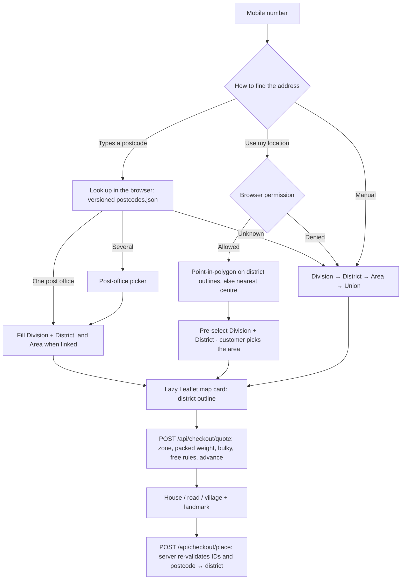
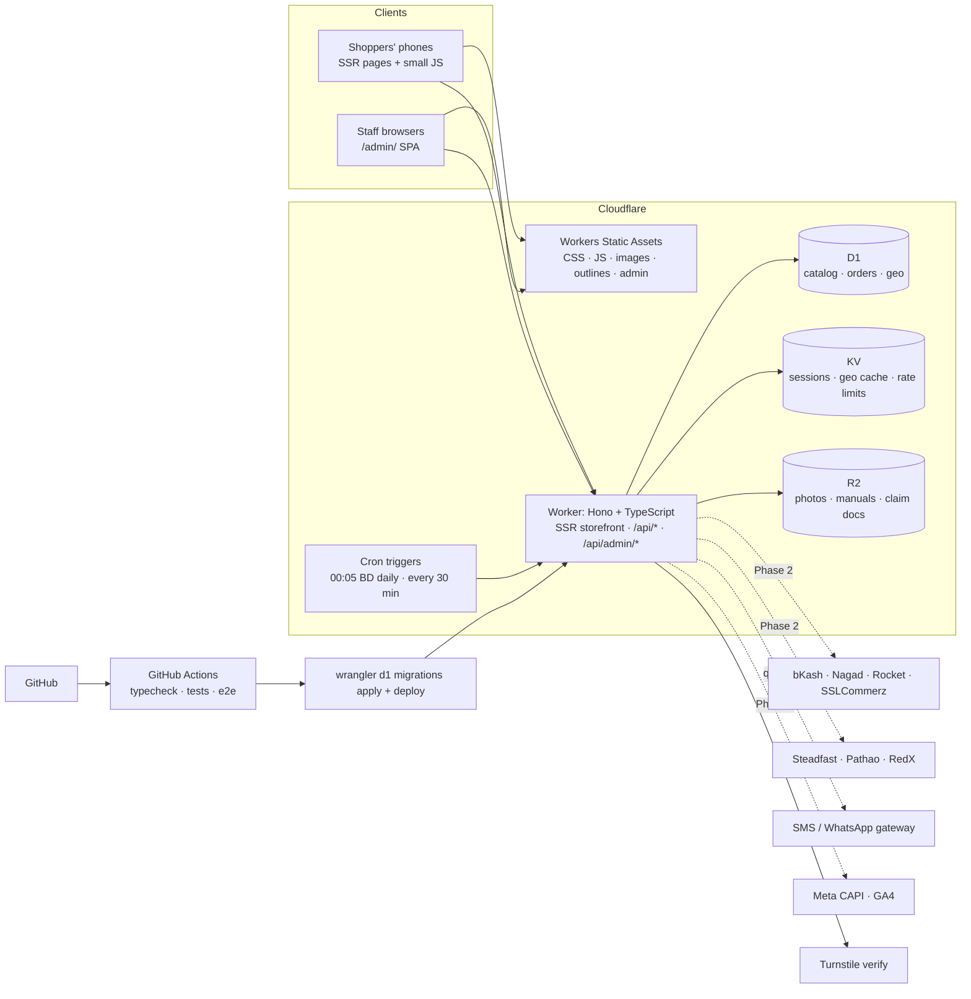

# Abs Vai (absvai.com): A–Z build specification

Client: **ABS VAI LTD** · Domain: **absvai.com** · Stack: Cloudflare Workers (Hono + TypeScript), D1, KV, R2, GitHub Actions.
English-only storefront and admin. Mobile-first, Bangladesh.

This document follows the numbering of the client's build prompt. Each section states the requirement, **what is built** in this
repository (with the files that implement it), and what is **planned** for Phase 2/3. "Built" means implemented and covered by the
test suites unless it says otherwise.

Legend: **Built** = in this release · **Planned P2 / P3** = later phase (database tables already exist).

---

## 1. Brand & Business Requirements

| Requirement | Status |
|---|---|
| Identity "Abs Vai", tagline placeholder *"Seasonal goods, honest prices."*, text wordmark until the logo is supplied | **Built**: wordmark in `views/layout.tsx`, tagline in settings (editable) |
| English everywhere (storefront, admin, invoices, SMS); no language toggle | **Built**. SMS go through `lib/sms.ts → toGsm7()` so every message is GSM-7 (160 chars/segment); a unit test checks every template fits one segment |
| Search understands transliterated names | **Built**: synonym groups (`search_synonyms`, `lib/search.ts`), admin-editable; "phuchka" → fuchka, "nolen gur" → patali gur, "moshla" → masala |
| COD default; bKash/Nagad/Rocket/cards; advances for pre-orders and bulky items | **Built**: COD + manual mobile-wallet advance with transaction ID and staff verification. **Planned P2**: bKash/Nagad/Rocket/SSLCommerz hosted gateways |
| Non-technical team | **Built**: every admin flow is a guided form with plain-language validation; Help Center + [OWNER-GUIDE](OWNER-GUIDE.md) |
| Own photos only | **Built** as policy: the repository contains only original placeholder drawings; credits page lists data sources. See [DESIGN-REVIEW](DESIGN-REVIEW.md) for which ad creatives must not be reused |

## 2. Public Website — Design & Navigation

**Visual direction**: "spice market meets Facebook ad". Tokens in `public/css/app.css`:

| Token | Hex | Use |
|---|---|---|
| `--chili` | `#B3261E` | Primary buttons, price bursts, Order Now |
| `--turmeric` | `#F2B705` | Kickers, pre-order tags, highlight bands (dark text only) |
| `--cream` | `#FFF8EC` | Page background |
| `--leaf` | `#2E7D32` | Check chips, In stock, free delivery, chat button |
| `--clove` | `#2A1F1A` | Text, footer |
| `--husk` | `#E9DCC6` | Borders |
| `--muted` | `#6B5A4E` | Secondary text |

WCAG AA is enforced by `tests/unit/contrast.test.ts` (it also proves yellow-on-cream fails, which is why turmeric never carries text).

| Element | Status | Where |
|---|---|---|
| Admin-editable announcement bar (marquee readable from the first frame, static on desktop and for reduced motion) | **Built** | layout + `settings.announcement` |
| Header: hamburger, wordmark, live-suggest search, wishlist, cart count | **Built** | `views/layout.tsx`, `public/js/app.js` |
| Drawer: In Season Now, All Categories (expandable), Originals, Hot Deals, Free Delivery, New Arrivals, food-business link, Track Order, Contact, Install App (only when the browser can install) | **Built**. Business Starter Kits and Recipes appear once those modules exist (**P3**) | |
| Homepage order: season hero → category carousel (active only, in-season first) → In Season Now → Originals ("Made by Abs Vai" seal) → Hot Deals + View all → food-business band → promo banner → New Arrivals → trust strip | **Built** | `views/pages.tsx → HomePage` |
| Bottom tabs: Home, Categories, Cart (raised, centre), Wishlist, Account | **Built** | |
| Floating chat: channel picker (WhatsApp, Messenger, Call). AI Support | **Built** / **P3** for AI | |
| Listing: template-driven Filter, Show 10/20/30/40, Sort (popular, newest, price, best selling, biggest saving) | **Built** | `data/catalog.ts → facets()` |
| Product card: image, burst, tags, name, key-spec line, price + strikethrough, unit price, Add to Cart + Order Now (stacked on narrow cards via container query) | **Built** | `views/components.tsx → Card` |
| Product page: gallery that follows the option's photo, template selectors (swatches for colour), per-option price/stock/unit price, tiers, check chips, delivery box, template info panels, size chart dialog, lite YouTube "How it works", related, sticky buy bar | **Built** | `ProductPage`, `public/js/product.js` |

## 3. Product Templates & Category → Attribute Mapping (core)

### 3.1 Four separate things

| Concept | Stored in | Creates variants? |
|---|---|---|
| Variant attributes (customer chooses) | `template_variant_attributes` → `attribute_types` / `attribute_values` | Yes, every combination is a row in `product_variants` |
| Specification fields (staff fill in) | `template_spec_fields` → values in `product_spec_values` | No |
| Shipping profile | `product_templates.default_shipping_profile`, overridable per product | No (packed weight is per variant) |
| Fulfilment mode | `product_templates.allowed_fulfilment` → `products.fulfilment_mode` | No |

### 3.2 Launch configuration (as shipped, `scripts/seed-defs.ts`)

| Category (code) | Template | Customer chooses | Required to publish (beyond basics) | Shipping | Fulfilment |
|---|---|---|---|---|---|
| Organic & Seasonal Food (ORG), sub: Khejur Gur (winter only) | `weighed_food` | Weight (250g–5kg presets) · Packaging (optional) | Net weight per option, origin, batch/date, best-before date, ingredients, storage | Perishable | In stock, pre-order |
| Spices & Masala (SPC) | `packaged_food` | Pack size (50g–1kg) | Net weight, full ingredients, best-before date, manufacturer/packer, usage. BSTI no. optional with prompt | Standard | In stock |
| Food Business Machines (MCH): Presses, Sealers | `machinery` | Size / model · Power type (optional) | Model no., body material, capacity, in the box, warranty period + who honours it | Heavy/bulky (overridable, e.g. a small sealer is standard) | In stock, made to order |
| Kitchen & Wooden Tools (TLS) | `handmade_tool` | Size · Finish (optional) | Wood type (can become an option), finish, dimensions, care | Standard | In stock, made to order |
| Home & Furniture (HOM) | `bulky_home` | Finish, Size (both optional) | Dimensions H×W×D, material (can become an option), assembly yes/no, max load, item weight | Heavy/bulky | In stock, made to order |
| Clothing (CLO), sub: Winter Wear (winter only) | `apparel` | Size + Color | Fabric, care, for (gender/age), **size chart covering every size** | Standard | In stock |
| Shoes (SHO) | `footwear` | Shoe size · Color (optional) | Upper + sole material, **size chart with foot length (cm)** | Standard | In stock |
| Gadgets & Electronics (GAD) | `electronics` | Color · Storage/model (optional) | Brand, model no., warranty + by whom, in the box, power/battery | Fragile | In stock |
| Accessories (ACC) | `simple` | Color (optional) or nothing | Material, dimensions | Standard | In stock |
| Packaging Supplies (PKG) | `pack_supply` | Size + Pack quantity | Material, dimensions, food-safe yes/no; net quantity in pcs (shows ৳/pc) | Standard | In stock |

### 3.3 Rules (all **Built**)

1. The upload form is generated from the template (`admin/js/views/products.js`). Food never shows Size/Color/Warranty; Machinery never shows a Weight selector. *Integration + E2E tested.*
2. Packed weight for delivery is required on every option of every template (separate from net weight). *Tested.*
3. Required fields block **publishing**, not saving. `lib/templates.ts → publishChecklist()` returns plain-language items; live products must keep passing.
4. "Customers choose this" promotes a `canBecomeVariant` spec to an option **for that product only** (`products.promoted_spec_keys`). *Tested.*
5. Presets with custom values ("+ Add your own", e.g. "3kg family pack").
6. Unit price is computed from net quantity (`lib/money.ts → unitPrice`): ৳/kg, ৳/litre, ৳/pc.
7. Templates are data: admins create templates from attribute types + spec fields (Templates screen). A template in use can only be retired. *Tested with a "Fresh produce" template (Weight + Grade).*
8. Info panels, card key-spec line and listing filters all come from the template (`infoPanels`, `cardKeySpecLine`, `facets`).

### 3.4 Worked examples (demo catalog, `worker/seed/demo.sql`)

| Product | Template | SKUs generated |
|---|---|---|
| Khejur Patali Gur (foil tray) | weighed_food | `ORG-PTGR-500G-0001`, `ORG-PTGR-1KG-0002`, `ORG-PTGR-2KG-0003` |
| 42 Item Master Masala | packaged_food | `SPC-MMSL-250G-0001` … `SPC-MMSL-1KG-0003` (wholesale tiers 5+ / 20+) |
| Electronic Impulse Sealer (PFS) | machinery | `MCH-SEAL-200MM-0001`, `MCH-SEAL-300MM-0002`, `MCH-SEAL-400MM-0003` |
| Manual Chanachur Press | machinery | `MCH-CHNC-4IN-0004`, `MCH-CHNC-6IN-0005` |
| Mahogany Velpuri & Fuchka Maker | handmade_tool | `TLS-VLPR-8X6-NAT-0001`, `TLS-VLPR-8X6-COL-0002` |
| Wooden Clothes Rack | bulky_home | `HOM-CRCK-STD-0001` |

## 4. Smart Product Upload Flow (admin) — **Built**

A 9-step slide-over: **1 Category** (template loads with a one-line explanation) → **2 Basics** (name, short + full description,
brand, Original toggle, up to 4 benefit chips) → **3 Details** (template spec fields with helper text, units, dimension inputs,
yes/no toggles, PDF fields, "Customers choose this") → **4 Options & prices** (preset chips, custom values, generated variant table:
price, original price, stock, packed weight, net qty, per-option photo, SKU auto or edited and checked for uniqueness, wholesale
tiers; bulk fill: same price/stock/packed weight, +৳ per size step; size chart editor when required) → **5 Photos & video** (drag and
drop, compressed to WebP ≤1600px in the browser, reordering, YouTube link, manual PDF, claim badges with documents) → **6 Season &
fulfilment** (seasons, in stock / pre-order with dispatch date + advance rule / made to order with lead days) → **7 Delivery** (free
delivery, shipping profile override, bulky charge mode) → **8 SEO** (slug, title, description, search names, Google preview) →
**9 Publish** (only what is left to do, card preview, Save draft / Schedule in Bangladesh time / Publish).

Extras: **Duplicate** (copies everything except SKUs and stock), **CSV import** with one downloadable layout per template (always
imports drafts), **inline card preview**, trash + restore. E2E test: `tests/e2e/checkout.test.mjs → admin smart upload form`.

## 5. Seasonal Business Engine

| Requirement | Status |
|---|---|
| Season calendar with name, dates, banners, accent label/colour, landing intro, "back from" text | **Built** (Seasons screen) |
| Lunar seasons never hard-coded: launch seasons ship **without dates**; "Copy last year's seasons" clears ended seasons' dates for confirmation; dashboard nags until dates are set | **Built** |
| Automatic switching of hero, In Season Now and category order/visibility at the BD-date boundary (inclusive) | **Built**: computed per request from `seasons`; nightly cron at 00:05 BD refreshes caches. *Unit + integration tested.* |
| Out-of-season: page stays live, "Back in season from November", Notify me (SMS/WhatsApp), no cart unless pre-order | **Built** (`lib/seasons.ts → productAvailability`) |
| Pre-orders with expected dispatch + advance (delivery charge or fixed) paid by bKash/Nagad; per-product pre-order list export | **Built** |
| Category visibility "Always" or "Only during [seasons]" | **Built** |
| Back-in-season messages when a season starts | **Built** (`cron/index.ts → seasonSwitch`, once per season start). *Tested.* |
| Dashboard reminder "Winter starts in 14 days, N hidden, M without stock" | **Built** (≤30 days) |
| Season planning report from real order data | **Planned P3** |

## 6. Checkout & Automatic Address Detection

### 6.1 Data sources (verified against the files, see [data/geo/SOURCES.md](../data/geo/SOURCES.md))

- **Bangladesh-geocode** pinned at `c97c694`: 8 divisions, 64 districts (with lat/lon), 494 upazilas, 4,540 unions, 64 district
  outlines. Dhaka division id is **6** (the upstream README's PHP example uses 1). Dhaka district id is 47.
- **Postcodes**: the same repository now ships `postcode-bd/postcode.csv` (1,349 rows, scraped from Wikipedia), so one pinned
  source is used instead of a second repository. It uses the old seven-division layout and Wikipedia spellings, so the division is
  always taken from the matched district.
- `scripts/import-geo.ts` links each postcode row to an upazila **within its district**: exact (734) → district-sadar alias (53) →
  spelling variant / edit distance with a unique best match (323, flagged *fuzzy* for review) → **unmatched (239)**, written to
  `data/geo/reports/` and fixable in admin (single fix or bulk assign). It never guesses.
- **City-corporation supplement**: the source has no city areas, so Dhaka city customers had nothing to pick. Twelve city
  corporations (ids 9001–9012, `source = 'absvai-supplement'`) are added under their districts; zones map them separately.
- Bangla names are imported but not shown.

### 6.2 Checkout experience — **Built** (`views/pages.tsx → CheckoutPage`, `public/js/checkout.js`)

Mobile number first (abandoned-checkout capture starts once it is valid) → name → **find your address** three ways (postcode with a
post-office picker; "Use my location" → point-in-polygon on simplified district outlines, nearest centre as fallback, message *"We've
set your district. Please choose your area."*; cascading Division → District → Area → Union dropdowns) → **map card** (Leaflet
self-hosted, loaded only after a district is known; outline only unless an admin adds a production tile provider) → house/road/
village + landmark → live delivery charge, explanation and ETA → summary, payment, Place order (Turnstile when configured).



### 6.3 Delivery charge rules — **Built** (`lib/delivery-charge.ts`, 11 unit tests + integration)

- Zones (admin): base charge up to a base weight, per-extra-kg (rounded up), bulky charge, ETA, one default. Resolution: area
  override → district → default. In Dhaka, the quote says *choose your area* until the area is picked (`needsArea`).
  Launch placeholders: Inside Dhaka City ৳70 · Dhaka Suburbs (Dhaka, Gazipur, Narayanganj districts) ৳100 · Outside Dhaka ৳130,
  +৳15/20/25 per extra kg, bulky ৳400/600/800.
- Packed weight × qty drives the charge. Heavy/bulky items use the zone's bulky charge per unit, or "confirmed by phone" (order held
  until staff set the charge).
- Free delivery: sitewide threshold (default ৳1,500, large items excluded unless changed) or every item free. Mixed carts pay.
- Optional COD fee is always its own line.

### 6.4 Performance, validation, privacy — **Built**

Geo JSON is served from versioned URLs (`/api/geo/<version>/hierarchy.json`, `postcodes.json`, `unions/<id>`; outlines as static
`/geo/<version>/…`) with `immutable` caching and loaded only on the checkout page. Admin postcode fixes bump the version, so
customers get the fix immediately. The server validates division ⊃ district ⊃ area ⊃ union and the postcode; a mismatch is a risk
signal, not a block. **No raw GPS is stored or sent.** `courier_area_map` holds per-courier city/zone/area IDs (admin screen).

## 7. Category & Landing Page System

| Requirement | Status |
|---|---|
| Unlimited categories: name, icon, parent, template, season visibility, active, order, SEO | **Built** |
| Season collection pages with a countdown to the **real** end date | **Built** (`/season/:slug`) |
| Ad-match single-product landing page with embedded order form; starter-kit page; per-page Pixel/CAPI + UTM | **Planned P2**. UTM/fbclid/gclid are already captured on every order (`orders.utm`). `placeOrder()` is shared, so landing forms will reuse it |

## 8. Admin Dashboard — Description & Layout

Three panes (`admin/`): collapsible left sidebar (all modules from the brief; later-phase modules are visible but labelled
"Phase 2/3"), centre panel, right sidebar (profile, quick links, notifications) on wide screens.
**Built modules**: Dashboard (KPIs, health strip, needs-attention list, season card, 14-day chart, recent orders, low stock), Orders
(pipeline tabs, search, bulk confirm/pack/ship/cancel, print invoices, detail with timeline, call log, advance verification,
delivery charge for bulky items, duplicate merge, test-order flag, invoice PDF), Products + smart form, Categories, Product
Templates (editor), Attribute Types, Inventory (adjust with batch no., history), Seasons, Pre-orders & Notify-me, Abandoned
checkouts, Customers (trusted flag), Wholesale Inquiries, Search synonyms, Delivery Zones, Postcodes & Geo, Courier Area Mapping,
Settings, Staff & Roles, SMS outbox, Audit log, Help Center. Interaction rules: slide-over forms, inline English validation, confirm
before delete, soft delete, toasts, role-based hiding (and server enforcement).

## 9. Full-Stack Architecture



## 10. Data Models

All money is **integer paisa**; dates for seasons/invoices are Bangladesh calendar dates. Full DDL: `worker/migrations/0001_schema.sql`.

| Group | Table | Key columns / purpose |
|---|---|---|
| Catalog | `attribute_types`, `attribute_values` | id, name, input (chips/swatch/select); values with optional swatch hex |
| | `product_templates` | id, name, explanation, default_shipping_profile, allowed_fulfilment[], requires_size_chart + columns, requires_brand, requires_net_quantity, card_key_specs[], status active/retired |
| | `template_variant_attributes` | template_id, attribute_type_id, required, preset_values[], allow_custom_values, sort |
| | `template_spec_fields` | template_id, key, label, type (text/longtext/number/date/select/dimensions/file/boolean), unit, required, help_text, placeholder, options[], panel, show_on_product_page, can_become_variant, filterable, card_format |
| | `categories` | slug, name, code (SKU), parent_id, template_id, season_visibility, active, sort, SEO, soft delete |
| | `products` | slug, category, template, name, code, descriptions, brand, is_original, benefit_chips[], status draft/scheduled/published/archived, publish_at, fulfilment_mode + pre-order/made-to-order fields, shipping_profile, bulky_delivery_mode, free_delivery, video_url, promoted_spec_keys[], size_chart, search_keywords, SEO, sold_count |
| | `product_spec_values` | product_id, field_key, value |
| | `product_variants` | sku (unique), attributes{}, attributes_key (unique per product), price, compare_at, wholesale_tiers[], stock (CHECK ≥ 0), packed_weight_grams, net_value + net_unit, image_ids[], active |
| | `product_media`, `product_claims` | images/manuals/claim docs in R2; a claim needs a `claim_doc` media row |
| | `bundles`, `bundle_items`, `search_synonyms` | starter kits (P3); synonym groups |
| Seasons | `seasons`, `product_seasons`, `category_seasons`, `notify_requests` | dates nullable (needs dates), banners[], back-in-season text, started_notified_on; notify phone + channel + status |
| Orders | `orders` | order_no (AV-/PRE-), access_token, invoice_no, status (9 states), fulfilment_type, payment method/status, advance_* fields, money breakdown, delivery zone + charge status, full address snapshot (IDs + names), risk level + reasons, duplicate_of, confirmation method, OTP time, courier + tracking, utm{}, is_test |
| | `order_items`, `order_events`, `order_otps` | SKU/name/variant snapshot; timeline (status, calls with outcome, payments, notes); hashed OTP with attempts/sends |
| | `invoices`, `payments`, `refunds`, `abandoned_checkouts` | INV numbers; advance/full/COD payments with TrxID; refunds (P2 UI); captured drafts |
| Customers | `customers`, `addresses`, `risk_flags` | phone unique, trusted, order/delivered/returned counts; addresses store IDs + typed line only (**no GPS**) |
| Geo & delivery | `geo_divisions`, `geo_districts` (lat, lon), `geo_upazilas` (kind upazila/city_corporation, source), `geo_unions` | imported hierarchy |
| | `geo_postcodes` | postcode, post_office, division/district/upazila ids, source names, match_status exact/alias/fuzzy/unmatched/manual, note |
| | `delivery_zones`, `zone_districts`, `zone_upazila_overrides`, `courier_area_map` | zone pricing and mapping; courier city/zone/area IDs |
| Operations | `inventory_log` (batch_no), `sms_outbox`, `coupons`, `reviews`, `recipes`, `recipe_products`, `wholesale_inquiries`, `admins`, `audit_log`, `landing_pages`, `counters`, `settings` | |

**Numbering** (`lib/numbering.ts`, single atomic `INSERT … ON CONFLICT … RETURNING`): SKUs `[Category]-[Product]-[Variant]-[Seq]`
with a sequence per category code; orders `AV-YYMMDD-####`, pre-orders `PRE-YYMMDD-####`; invoices `INV-YYYYMMDD-####` issued on
confirmation, with a PDF (`lib/invoice.ts`, dependency-free writer, ASCII "Tk" amounts; an HTML print view renders any script).

```ts
interface ProductTemplate {
  id: string;                         // "weighed_food"
  name: string;                       // "Weighed food"
  explanation: string;                // one line shown in the upload form
  variantAttributes: { attributeTypeId: string; label: string; required: boolean; presetValues: string[]; allowCustomValues: boolean; input: 'chips' | 'swatch' | 'select' }[];
  specFields: {
    key: string; label: string;
    type: 'text' | 'longtext' | 'number' | 'date' | 'select' | 'dimensions' | 'file' | 'boolean';
    unit?: string | null; required: boolean; helpText?: string | null; placeholder?: string | null; options?: string[] | null;
    panel: string; showOnProductPage: boolean; canBecomeVariant: boolean; filterable: boolean; cardFormat?: string | null;
  }[];
  defaultShippingProfile: 'standard' | 'fragile' | 'heavy_bulky' | 'perishable';
  allowedFulfilment: ('in_stock' | 'pre_order' | 'made_to_order')[];
  requiresSizeChart: boolean; sizeChartColumns: string[]; requiresBrand: boolean; requiresNetQuantity: boolean;
  cardKeySpecs: string[];             // ["net_weight", "origin"] or ["variant.model_size", "warranty_period"]
  status: 'active' | 'retired';
}

interface ProductVariant {
  id: number; sku: string;
  attributes: Record<string, string>; // { weight: "1kg" } | { apparel_size: "L", color: "Red" } | { model_size: "300mm" }
  pricePaisa: number; compareAtPricePaisa: number | null;
  wholesaleTiers: { minQty: number; pricePaisa: number }[];
  stock: number;
  packedWeightGrams: number;          // always required to publish: drives the delivery charge
  netValue: number | null; netUnit: 'g' | 'kg' | 'ml' | 'l' | 'pcs' | null; // drives "৳ per kg"
  imageIds: number[]; isActive: boolean;
}
```

(Source of truth: `worker/src/lib/templates.ts` and `worker/src/data/catalog.ts`.)

## 11. Payments, Delivery & Third-Party Integrations

| Item | Status |
|---|---|
| COD | **Built** |
| Advances by bKash/Nagad/Rocket "send money + transaction ID", verified by staff; amounts and refund promise shown before payment | **Built** |
| Hosted gateways (bKash, Nagad, Rocket, SSLCommerz) with automatic reconciliation | **Planned P2** (`payments` table ready) |
| Couriers: order push, tracking sync, webhooks; "Own delivery" with a note | Manual courier + tracking ID per order, bulk ship **Built**; APIs **Planned P2** using `courier_area_map` |
| SMS/WhatsApp (English): received, OTP, confirmed, shipped (tracking), delivered, back in season | **Built** into `sms_outbox` (status `logged` until a gateway is configured); delivery worker **P2** |
| Meta Pixel + CAPI (shared event_id, hashed phone, Purchase only on confirmed non-test orders), GA4, Ads, Clarity | IDs storable in settings; UTM/click IDs saved on orders; `is_test` excluded. Firing events **Planned P2** |

## 12. Fraud Prevention & Abandoned-Checkout Capture

| Item | Status |
|---|---|
| OTP **or** a logged confirmation call before any COD order is confirmed | **Built** (`lib/order-status.ts → confirmBlockers`). *Tested both paths.* OTP: 6 digits, SHA-256 with pepper, 15 min, 5 tries, 3 sends |
| Risk badge Low/Medium/High; trusted fast lane | **Built** (`lib/risk.ts`): postcode mismatch, short address, possible duplicate, velocity (3+/24 h), earlier returns, high value from new customer |
| Courier fraud-check lookup | **Planned P2** |
| Velocity limits + Turnstile on checkout | **Built**: KV rate limits on place order, drafts, tracking, OTP, notify, login, setup; Turnstile enforced when `TURNSTILE_SECRET` is set |
| Abandoned checkout capture (phone first, as typed) with a notice to the customer | **Built** |
| Advance required: pre-orders, heavy/bulky, high value from new or risky customers | **Built** (`services/checkout.ts → advanceFor`) |
| Duplicate-order detection (same phone + same items in 10 min) with a merge prompt | **Built** |

## 13. Food Product Compliance & Honest Claims

- Food templates require net weight, ingredients, best-before, storage; packaged food also requires manufacturer/packer and
  usage, and prompts for a BSTI/licence number. **Verify the exact label rules with BSTI and the Bangladesh Food Safety Authority**,
  especially for Master Masala.
- Claim badges ("Organic", "100% Natural", "Adulteration-free", …) can only be switched on with an attached document (**Built**, tested).
- Health/medical claims ("cures", "boosts immunity", …) fail the publish checklist and block saving live products (**Built**, tested).
- Batch numbers are recorded on stock receipts; the inventory log can be filtered by batch (**Built**).
- Product policy: do **not** list raw date-palm sap (kacha khejur rosh): Nipah virus risk. Boiled gur and patali are fine.
- Honest urgency: the season countdown runs to the real end date; stock counts are real ("only 3 left" uses actual stock); no
  viewer counts or fake reviews anywhere (an integration test asserts the homepage has no "people viewing" text).

## 14. Security & Compliance (NIST CSF view)

| Function | Built controls |
|---|---|
| Govern / Identify | Roles Super Admin / Manager / Order Processor / Viewer (`lib/auth.ts → can`); audit log of every admin write; data inventory in this document |
| Protect | PBKDF2-SHA256 (100k iterations, the Workers maximum; no native Argon2/bcrypt in Workers) with per-password salt; first admin only via the `SETUP_TOKEN` secret; KV sessions in `__Host-` cookies (HttpOnly, Secure, SameSite=Strict, 12 h); CSRF token + Origin check on every admin write; server-side RBAC on every route; strict CSP without inline scripts (Worker responses and static assets via `_headers`), HSTS, frame-ancestors none, nosniff; input validation on every endpoint including geo IDs, postcodes and file types; secrets only as Wrangler secrets; PCI scope kept out by using hosted payment pages (P2) |
| Detect | Rate limits; risk flags; audit log; SMS outbox |
| Respond | Order cancel/merge tools; staff deactivation; sessions expire in 12 h |
| Recover | D1 Time Travel restores (see below); migrations in git; R2 objects immutable |

**D1 backup/restore**: D1 keeps 30 days of point-in-time history. `npx wrangler d1 time-travel info absvai` and
`npx wrangler d1 time-travel restore absvai --timestamp=<ISO>`; also export weekly with `npx wrangler d1 export absvai --remote --output=backup.sql`.

**Incident outline**: 1) contain (rotate `SETUP_TOKEN`/`OTP_PEPPER`/API keys, deactivate staff, clear KV `sess:*`), 2) assess with
the audit log and Worker logs, 3) restore D1 if needed, 4) inform affected customers, 5) write up and fix.

## 15. Testing Strategy — **Built**

| Suite | Count | What it proves |
|---|---|---|
| Unit (`tests/unit`) | 77 | SKUs (prompt examples), money/unit price/tiers, templates (each launch template's fields, publish blocking, promote-to-variant isolation, combinations, card lines, panels), delivery charges (zones, weight, threshold boundary, mixed carts, bulky, confirm-by-phone, COD fee), nearest district + point-in-polygon for 5 known places, postcode matching, seasons (inclusive boundaries, pre-orders, undated seasons), order pipeline + COD guard, risk, synonyms, phones, GSM-7 SMS, BD dates, PDF structure, WCAG contrast |
| Integration (`tests/integration`) | 38 | The real Hono app on local D1/KV/R2 (workerd): geo endpoints (1000 → Dhaka), division/district validation, zone quotes incl. bulky + free, out-of-season page + checkout block, notify-me + cron, pre-order advance + PRE-, OTP and call confirmation, invoice sequence + PDF, duplicates, wholesale tiers, stock limits, admin template-driven forms, best-before blocking, machinery without weight, promote-to-variant, new template + category, SKU uniqueness, CSV, claims, CSRF/RBAC/audit, SSR/SEO/sitemap/security headers, scheduled publish |
| E2E (`tests/e2e`, Playwright) | 6 | Weighed food with postcode, clothing size + colour via cart with location detection + map, machine via the card option picker, pre-order with bKash TrxID, notify-me, admin upload form from setup to publish |
| CI | | typecheck, generated-file drift check, all suites, then deploy on `main` |

Landing-page embedded orders are tested when landing pages ship (P2).

## 16. Dashboard Development Plan — **Built**

Vanilla ES modules, no build step, no framework (`admin/js`), an inline SVG chart, usable on tablets and large phones (sidebar
becomes a drawer). Loading, empty and error states on every list and form; the upload form and the checkout address finder have
explicit messages for every failure path (no location permission, unknown postcode, outside Bangladesh, area list failed to load).

## 17. File & Folder Structure

See the [README](../README.md#folder-structure). It matches the brief's tree; the extra folders are `services/` (shared order logic),
`views/` (JSX) and `data/` (queries).

## 18. Development Environment & Deployment Setup — **Built**

Node 22 LTS, Wrangler 4, `.dev.vars.example`, `worker/wrangler.toml` (D1/KV/R2 bindings, custom domains, cron triggers, assets).
Geo setup: pinned files in `data/geo/source`, `npm run gen:geo`, review `data/geo/reports`, apply migration `0002`. Branch
strategy: feature branches → PR (CI) → `main` (migrate + deploy). Commands in the README.

## 19. SEO, Performance & Marketing

| Item | Status |
|---|---|
| Titles, descriptions, canonical, Open Graph/Twitter cards, `og-default.png` | **Built** |
| `sitemap.xml` (products, categories, all season pages year-round), `robots.txt` | **Built** |
| `Product` JSON-LD with offers/AggregateOffer, availability (InStock/PreOrder/OutOfStock), BDT price; `BreadcrumbList`; Organization + WebSite SearchAction | **Built** |
| `Recipe` / `HowTo` JSON-LD on the recipes hub | **Planned P3** |
| Search synonyms (admin-managed) + per-product search names | **Built** |
| Filtered/paged listings are `noindex`; out-of-season pages stay indexed | **Built** |
| Performance: SSR HTML, one 42 KB stylesheet (≈9 KB compressed), small JS modules, lazy images with sizes, no inline JS, fonts with `display=swap`, geo data and Leaflet only on checkout | **Built**. Cloudflare Image Resizing (`/cdn-cgi/image/…`) for R2 photos once the zone has it enabled |
| WhatsApp click-to-chat | **Built**. Facebook/Instagram catalog feed respecting seasons: **Planned P2** |

## 20. Additional Premium Features

| Item | Status |
|---|---|
| Wholesale tier prices applied automatically in the cart | **Built** |
| "Become a dealer / bulk inquiry" form → Wholesale Inquiries | **Built** |
| Back-in-season alerts | **Built** |
| "How it works" video (privacy-friendly youtube-nocookie, loaded on tap) and PDF manuals | **Built** |
| Unit-price comparison on weighed products | **Built** |
| Business Starter Kits (stock from components), "Reorder" in account | **Planned P3** (`bundles` tables exist) |
| Honesty guardrail (no fake counts, reviews, or resetting timers) | **Built** |

## 21. Owner-Friendly Operations & Onboarding

| Item | Status |
|---|---|
| Guided first-run: setup token → Super Admin; launch zones, templates, categories and seasons come pre-configured | **Built** (step-by-step wizard for zones/payments: P2) |
| "Needs your attention today" (confirmations, advances, abandoned, low stock, pre-orders, unmatched postcodes, undated seasons, season starting soon, expired best-before) | **Built** |
| Health strip (COD, wallets, SMS, Turnstile, courier) | **Built** |
| Bulk actions: confirm/pack/ship/cancel, print invoices | **Built**; push to courier: P2 |
| CSV export (orders, pre-orders) | **Built**; other lists: P2 |
| Owner guide with screenshots | **Built**: [OWNER-GUIDE](OWNER-GUIDE.md) |

## 22. Phased Roadmap

- **Phase 1 (this repository)**: templates + smart upload form, launch categories, ad-continuity storefront, cart, one-page COD
  checkout with postcode/location/manual detection, delivery zones, SKU + invoice numbering, admin. *Also delivered early:* seasons
  engine with notify-me and pre-orders, manual advances, risk signals, abandoned-checkout capture, wholesale tiers, dealer inquiries.
- **Phase 2**: bKash/Nagad/Rocket/SSLCommerz gateways; courier APIs (Steadfast first) with area mapping and webhooks; courier fraud
  check; Meta Pixel + CAPI with deduplication; landing-page builder (ad-match, seasonal, starter-kit) with embedded order forms;
  coupons; reviews; SMS gateway worker; Facebook catalog feed.
- **Phase 3**: Business Starter Kits; Recipes & Business Ideas hub (Recipe/HowTo JSON-LD); AI chat answering from store data with
  human hand-over; season planning report; PWA offline browsing; customer sign-in with OTP and reorder.

## 23. Development & Delivery Conventions

Clean checkout, complete files, TypeScript build check in CI, plain English copy, no secrets in the repository (`.dev.vars` is
git-ignored; only `.dev.vars.example` is committed), and every geo/courier ID comes from data files or admin configuration (zone
mappings in the seed SQL are resolved by name against the imported rows, never by an assumed ID).

## 24. Acceptance Checklist

| # | Item | Result |
|---|---|---|
| 1 | Storefront, admin, invoices and SMS English-only; no language toggle | ✅ |
| 2 | Organic & Seasonal Food shows Weight presets + origin, batch, best-before, storage; cannot publish without best-before | ✅ unit, integration, E2E |
| 3 | Food Business Machines shows Size/Model + warranty + in the box, no Weight selector; packed weight still required | ✅ unit, integration |
| 4 | Clothing Size + Color with size chart; Shoes size with foot-length chart; Accessories with no variants | ✅ unit |
| 5 | Admin creates a new template + category (Mango: Weight + Grade) without a developer | ✅ integration |
| 6 | "Customers choose this" promotes a spec for one product only | ✅ unit, integration |
| 7 | Postcode auto-fills Division, District (and Area when linked) and shows the post office; location says district-level; dropdowns always work | ✅ E2E. Area fills for the 1,110 linked postcodes; the 239 unlinked ones fill the district and ask for the area until fixed in admin |
| 8 | Import writes a match report; unmatched postcodes fixable in admin | ✅ |
| 9 | Detected district highlighted on a lazy-loaded map; no raw GPS stored | ✅ |
| 10 | Delivery charge recalculates live by zone, packed weight, bulky profile, free rules | ✅ |
| 11 | Seasons switch hero, rails, category visibility; out-of-season pages stay live with Notify me | ✅ |
| 12 | Pre-orders take an advance and appear in the pre-order list | ✅ (manual wallet TrxID now; gateway P2) |
| 13 | Unique SKU per variant; sequential invoice number + PDF per confirmed order | ✅ |
| 14 | COD can't be confirmed without OTP or a logged call | ✅ |
| 15 | Pixel and CAPI share an event_id; Purchase only for real confirmed orders | ⏳ Phase 2 (test-order flag and confirmed status are in place) |
| 16 | Food claim badges need a document; no health claims | ✅ |
| 17 | No logo, branding or photo from any reference site or third-party shop | ✅ original placeholder art only |
| 18 | No secrets in the repository | ✅ |
